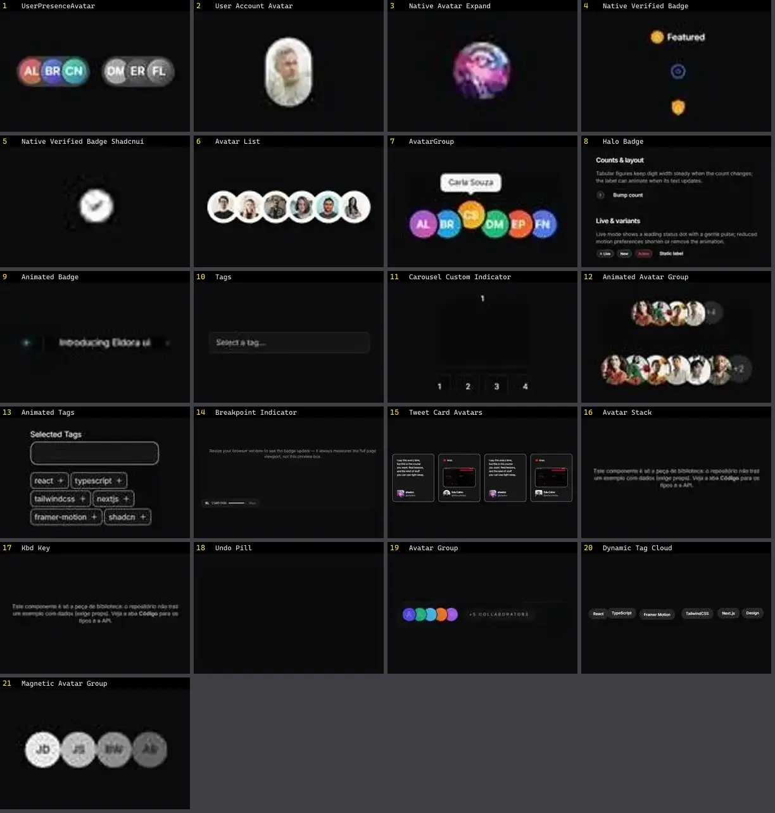

# Badge & Avatar — folha 1

| nº | nome | uid | tipo de aplicação |
|---|---|---|---|
| 1 | UserPresenceAvatar | `atlas:Misc/UserPresenceAvatar` | Login & Conta |
| 2 | User Account Avatar | `smoothui:user-account-avatar` | Login & Conta |
| 3 | Native Avatar Expand | `uitripled:native/demo/native-avatar-expand-demo` | Mobile & App |
| 4 | Native Verified Badge | `uitripled:native/demo/native-verified-badge-demo` | Mobile & App |
| 5 | Native Verified Badge Shadcnui | `uitripled:native/native-verified-badge-shadcnui` | Mobile & App |
| 6 | Avatar List | `animata:list/avatar-list` | UI base |
| 7 | AvatarGroup | `atlas:Lists/AvatarGroup` | UI base |
| 8 | Halo Badge | `cultui:halo-badge-demo` | UI base |
| 9 | Animated Badge | `eldoraui:animated-badge-demo` | UI base |
| 10 | Tags | `kibo:tags` | UI base |
| 11 | Carousel Custom Indicator | `motionprimitives:carousel/carousel-custom-indicator` | UI base |
| 12 | Animated Avatar Group | `smoothui:animated-avatar-group` | UI base |
| 13 | Animated Tags | `smoothui:animated-tags` | UI base |
| 14 | Breakpoint Indicator | `smoothui:breakpoint-indicator` | UI base |
| 15 | Tweet Card Avatars | `smoothui:tweet-card-avatars` | UI base |
| 16 | Avatar Stack | `spectrumui:avatar-stack` | UI base |
| 17 | Kbd Key | `spectrumui:kbd-key` | UI base |
| 18 | Undo Pill | `spectrumui:undo-pill` | UI base |
| 19 | Avatar Group | `uitripled:avatars/avatar-group` | UI base |
| 20 | Dynamic Tag Cloud | `uitripled:motion-core/dynamic-tag-cloud` | UI base |
| 21 | Magnetic Avatar Group | `uitripled:motion-core/magnetic-avatar-group` | UI base |
