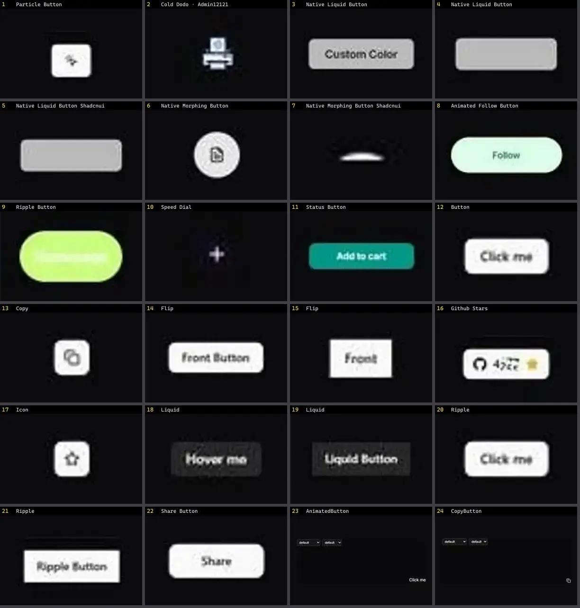

# Botão — folha 1

| nº | nome | uid | tipo de aplicação |
|---|---|---|---|
| 1 | Particle Button | `kokonutui:particle-button` | Blog & Conteúdo |
| 2 | Cold Dodo · Admin12121 | `uiverse:Buttons/Admin12121_cold-dodo-65` | Dashboard & Admin |
| 3 | Native Liquid Button | `uitripled:native/demo/native-liquid-button-demo` | Mobile & App |
| 4 | Native Liquid Button | `uitripled:native/native-liquid-button` | Mobile & App |
| 5 | Native Liquid Button Shadcnui | `uitripled:native/native-liquid-button-shadcnui` | Mobile & App |
| 6 | Native Morphing Button | `uitripled:native/demo/native-morphing-button-demo` | Mobile & App |
| 7 | Native Morphing Button Shadcnui | `uitripled:native/native-morphing-button-shadcnui` | Mobile & App |
| 8 | Animated Follow Button | `animata:button/animated-follow-button` | UI base |
| 9 | Ripple Button | `animata:button/ripple-button` | UI base |
| 10 | Speed Dial | `animata:fabs/speed-dial` | UI base |
| 11 | Status Button | `animata:button/status-button` | UI base |
| 12 | AnimatedButton | `atlas:Buttons/AnimatedButton` | UI base |
| 13 | CopyButton | `atlas:Buttons/CopyButton` | UI base |
| 14 | FlipButton | `atlas:Buttons/FlipButton` | UI base |
| 15 | GithubStarsButton | `atlas:Buttons/GithubStarsButton` | UI base |
| 16 | IconBurstButton | `atlas:Buttons/IconBurstButton` | UI base |
| 17 | LiquidButton | `atlas:Buttons/LiquidButton` | UI base |
| 18 | RippleButton | `atlas:Buttons/RippleButton` | UI base |
| 19 | ShareButton | `atlas:Buttons/ShareButton` | UI base |
| 20 | Button | `bundui:ripple-effect/button` | UI base |
| 21 | Floating Button | `bundui:floating-button` | UI base |
| 22 | Magnetic Button | `bundui:magnetic-button` | UI base |
| 23 | Bg Animated Fractal Dot Grid | `cultui:bg-animated-fractal-dot-grid-demo` | UI base |
| 24 | Border Beam Button | `cultui:border-beam-button-demo` | UI base |
