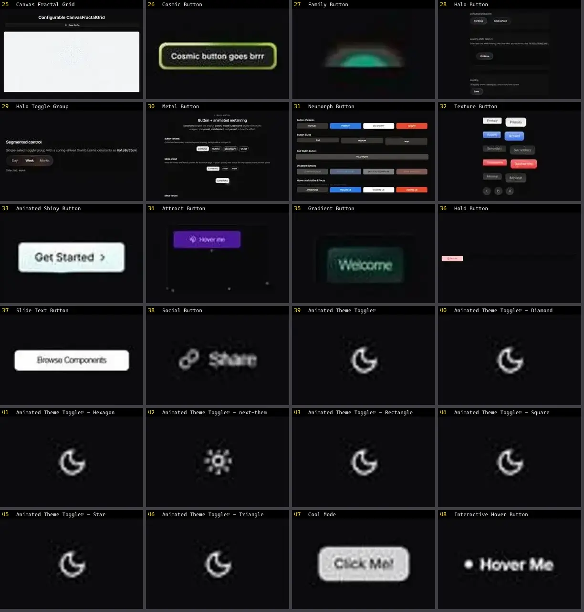

# Botão — folha 2

| nº | nome | uid | tipo de aplicação |
|---|---|---|---|
| 25 | Canvas Fractal Grid | `cultui:canvas-fractal-grid-demo` | UI base |
| 26 | Cosmic Button | `cultui:cosmic-button-demo` | UI base |
| 27 | Family Button | `cultui:family-button-demo` | UI base |
| 28 | Halo Button | `cultui:halo-button-demo` | UI base |
| 29 | Halo Toggle Group | `cultui:halo-toggle-group-demo` | UI base |
| 30 | Metal Button | `cultui:metal-button-demo` | UI base |
| 31 | Neumorph Button | `cultui:neumorph-button-demo` | UI base |
| 32 | Texture Button | `cultui:texture-button-demo` | UI base |
| 33 | Animated Shiny Button | `eldoraui:animated-shiny-button-demo` | UI base |
| 34 | Attract Button | `kokonutui:attract-button` | UI base |
| 35 | Gradient Button | `kokonutui:gradient-button` | UI base |
| 36 | Hold Button | `kokonutui:hold-button` | UI base |
| 37 | Slide Text Button | `kokonutui:slide-text-button` | UI base |
| 38 | Social Button | `kokonutui:social-button` | UI base |
| 39 | Animated Theme Toggler | `magicui:animated-theme-toggler-demo` | UI base |
| 40 | Animated Theme Toggler — Diamond | `magicui:animated-theme-toggler-diamond-demo` | UI base |
| 41 | Animated Theme Toggler — Hexagon | `magicui:animated-theme-toggler-hexagon-demo` | UI base |
| 42 | Animated Theme Toggler — next-themes | `magicui:animated-theme-toggler-next-themes-demo` | UI base |
| 43 | Animated Theme Toggler — Rectangle | `magicui:animated-theme-toggler-rectangle-demo` | UI base |
| 44 | Animated Theme Toggler — Square | `magicui:animated-theme-toggler-square-demo` | UI base |
| 45 | Animated Theme Toggler — Star | `magicui:animated-theme-toggler-star-demo` | UI base |
| 46 | Animated Theme Toggler — Triangle | `magicui:animated-theme-toggler-triangle-demo` | UI base |
| 47 | Cool Mode | `magicui:cool-mode-demo` | UI base |
| 48 | Interactive Hover Button | `magicui:interactive-hover-button-demo` | UI base |
