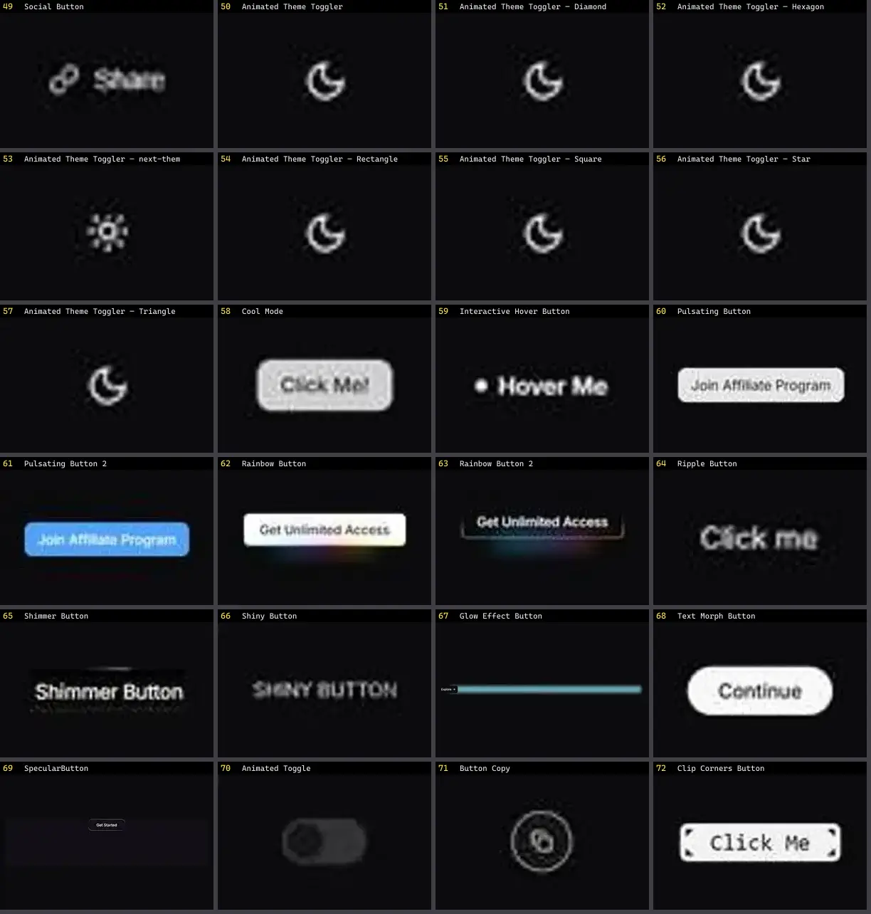

# Botão — folha 3

| nº | nome | uid | tipo de aplicação |
|---|---|---|---|
| 49 | Pulsating Button | `magicui:pulsating-button-demo` | UI base |
| 50 | Pulsating Button 2 | `magicui:pulsating-button-demo-2` | UI base |
| 51 | Rainbow Button | `magicui:rainbow-button-demo` | UI base |
| 52 | Rainbow Button 2 | `magicui:rainbow-button-demo-2` | UI base |
| 53 | Ripple Button | `magicui:ripple-button-demo` | UI base |
| 54 | Shimmer Button | `magicui:shimmer-button-demo` | UI base |
| 55 | Shiny Button | `magicui:shiny-button-demo` | UI base |
| 56 | Glow Effect Button | `motionprimitives:glow-effect/glow-effect-button` | UI base |
| 57 | Text Morph Button | `motionprimitives:text-morph/text-morph-button` | UI base |
| 58 | Animated Toggle | `smoothui:animated-toggle` | UI base |
| 59 | Button Copy | `smoothui:button-copy` | UI base |
| 60 | Clip Corners Button | `smoothui:clip-corners-button` | UI base |
| 61 | Cta 2 | `smoothui:cta-2` | UI base |
| 62 | Dot Morph Button | `smoothui:dot-morph-button` | UI base |
| 63 | Magnetic Button | `smoothui:magnetic-button` | UI base |
| 64 | Music Toggle | `smoothui:music-toggle` | UI base |
| 65 | Smooth Button | `smoothui:smooth-button` | UI base |
| 66 | Theme Toggle | `smoothui:theme-toggle` | UI base |
| 67 | ButtonCollection | `spectrumui:ButtonCollection` | UI base |
| 68 | Follow Button | `spectrumui:follow-button` | UI base |
| 69 | Like Button | `spectrumui:like-button` | UI base |
| 70 | Metal Button | `spectrumui:metal-button` | UI base |
| 71 | Morph Button | `spectrumui:morph-button` | UI base |
| 72 | Sales Cta Footer | `spectrumui:blocks/footers/sales-cta-footer` | UI base |
