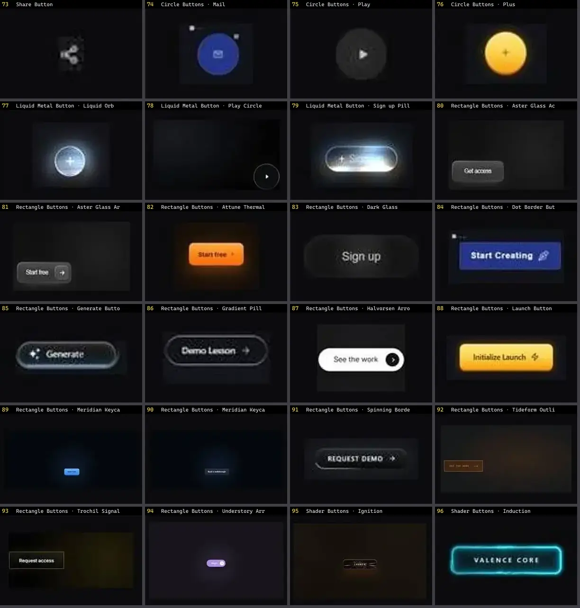

# Botão — folha 4

| nº | nome | uid | tipo de aplicação |
|---|---|---|---|
| 73 | Share Button | `spectrumui:share-button` | UI base |
| 74 | Circle Buttons · Mail | `threeui:circle-buttons/mail` | UI base |
| 75 | Circle Buttons · Play | `threeui:circle-buttons/play` | UI base |
| 76 | Circle Buttons · Plus | `threeui:circle-buttons/plus` | UI base |
| 77 | Liquid Metal Button · Liquid Orb | `threeui:liquid-metal-button/circle` | UI base |
| 78 | Liquid Metal Button · Play Circle | `threeui:liquid-metal-button/play-circle` | UI base |
| 79 | Liquid Metal Button · Sign up Pill | `threeui:liquid-metal-button/pill` | UI base |
| 80 | Rectangle Buttons · Aster Glass Access | `threeui:rectangle-buttons/aster-glass-access` | UI base |
| 81 | Rectangle Buttons · Aster Glass Arrow | `threeui:rectangle-buttons/aster-glass-arrow` | UI base |
| 82 | Rectangle Buttons · Attune Thermal | `threeui:rectangle-buttons/attune-thermal` | UI base |
| 83 | Rectangle Buttons · Dark Glass | `threeui:rectangle-buttons/dark-pill` | UI base |
| 84 | Rectangle Buttons · Dot Border Button | `threeui:rectangle-buttons/dot-border-button` | UI base |
| 85 | Rectangle Buttons · Generate Button | `threeui:rectangle-buttons/generate-button` | UI base |
| 86 | Rectangle Buttons · Gradient Pill Button | `threeui:rectangle-buttons/gradient-pill-button` | UI base |
| 87 | Rectangle Buttons · Halvorsen Arrow Pill | `threeui:rectangle-buttons/halvorsen-arrow-pill` | UI base |
| 88 | Rectangle Buttons · Launch Button | `threeui:rectangle-buttons/launch-button` | UI base |
| 89 | Rectangle Buttons · Meridian Keycap Primary | `threeui:rectangle-buttons/meridian-keycap-primary` | UI base |
| 90 | Rectangle Buttons · Meridian Keycap Secondary | `threeui:rectangle-buttons/meridian-keycap-secondary` | UI base |
| 91 | Rectangle Buttons · Spinning Border Button | `threeui:rectangle-buttons/spinning-border-button` | UI base |
| 92 | Rectangle Buttons · Tideform Outline | `threeui:rectangle-buttons/tideform-outline` | UI base |
| 93 | Rectangle Buttons · Trochil Signal | `threeui:rectangle-buttons/trochil-signal` | UI base |
| 94 | Rectangle Buttons · Understory Arrow Pill | `threeui:rectangle-buttons/understory-arrow-pill` | UI base |
| 95 | Shader Buttons · Ignition | `threeui:star-portal/ignition-button` | UI base |
| 96 | Shader Buttons · Induction | `threeui:star-portal/induction-button` | UI base |
