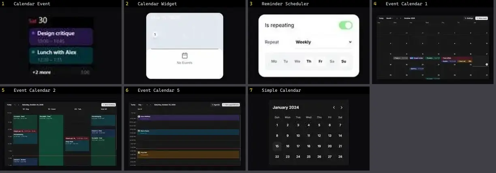

# Calendário & Data — folha 1

| nº | nome | uid | tipo de aplicação |
|---|---|---|---|
| 1 | Calendar Event | `animata:widget/calendar-event` | Dashboard & Admin |
| 2 | Calendar Widget | `animata:widget/calendar-widget` | Dashboard & Admin |
| 3 | Reminder Scheduler | `animata:card/reminder-scheduler` | Dashboard & Admin |
| 4 | Event Calendar 1 | `reui:event-calendar/c-event-calendar-1` | Dashboard & Admin |
| 5 | Event Calendar 2 | `reui:event-calendar/c-event-calendar-2` | Dashboard & Admin |
| 6 | Event Calendar 5 | `reui:event-calendar/c-event-calendar-5` | Dashboard & Admin |
| 7 | Simple Calendar | `uitripled:forms/simple-calendar` | Dashboard & Admin |
