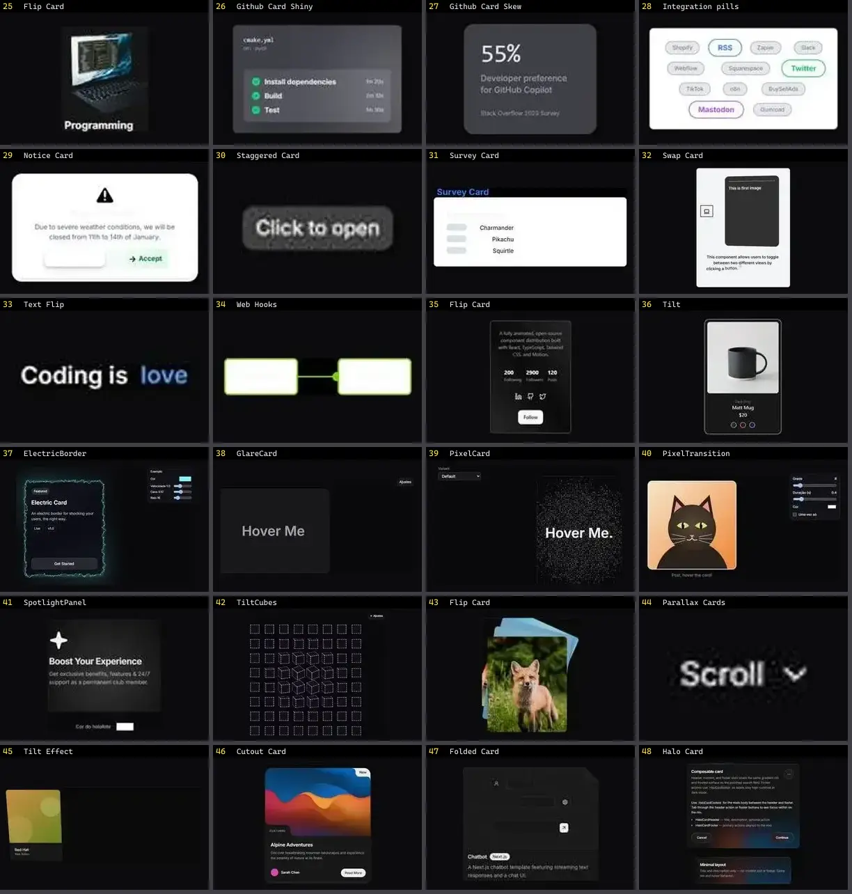

# Card — folha 2

| nº | nome | uid | tipo de aplicação |
|---|---|---|---|
| 25 | Flip Card | `animata:card/flip-card` | UI base |
| 26 | Github Card Shiny | `animata:card/github-card-shiny` | UI base |
| 27 | Github Card Skew | `animata:card/github-card-skew` | UI base |
| 28 | Integration pills | `animata:card/integration-pills` | UI base |
| 29 | Notice Card | `animata:card/notice-card` | UI base |
| 30 | Staggered Card | `animata:card/staggered-card` | UI base |
| 31 | Survey Card | `animata:card/survey-card` | UI base |
| 32 | Swap Card | `animata:card/swap-card` | UI base |
| 33 | Text Flip | `animata:text/text-flip` | UI base |
| 34 | Web Hooks | `animata:card/webhooks-card` | UI base |
| 35 | Flip Card | `animateui:components/community/flip-card` | UI base |
| 36 | Tilt | `animateui:primitives/effects/tilt` | UI base |
| 37 | ElectricBorder | `atlas:Cards/ElectricBorder` | UI base |
| 38 | GlareCard | `atlas:Cards/GlareCard` | UI base |
| 39 | PixelCard | `atlas:Cards/PixelCard` | UI base |
| 40 | PixelTransition | `atlas:Cards/PixelTransition` | UI base |
| 41 | SpotlightPanel | `atlas:Cards/SpotlightPanel` | UI base |
| 42 | TiltCubes | `atlas:Interactions/TiltCubes` | UI base |
| 43 | Flip Card | `bundui:flip-card` | UI base |
| 44 | Parallax Cards | `bundui:parallax-cards` | UI base |
| 45 | Tilt Effect | `bundui:tilt-effect` | UI base |
| 46 | Cutout Card | `cultui:cutout-card-demo` | UI base |
| 47 | Folded Card | `cultui:folded-card-demo` | UI base |
| 48 | Halo Card | `cultui:halo-card-demo` | UI base |
