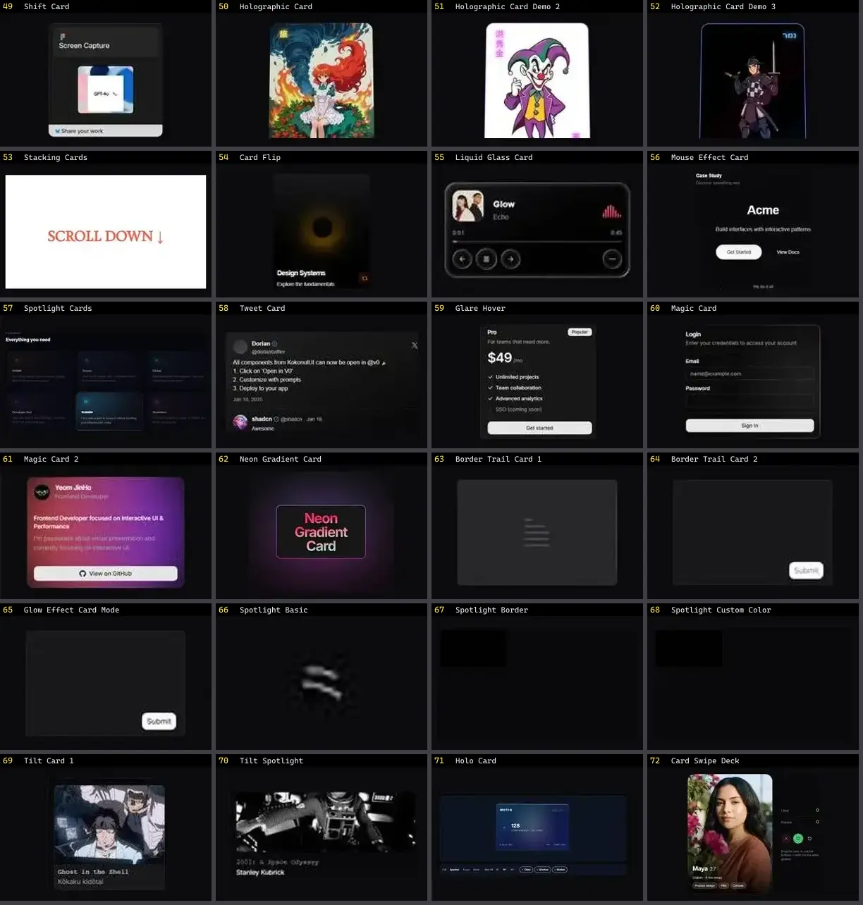

# Card — folha 3

| nº | nome | uid | tipo de aplicação |
|---|---|---|---|
| 49 | Shift Card | `cultui:shift-card-demo` | UI base |
| 50 | Holographic Card | `eldoraui:holographic-card-demo` | UI base |
| 51 | Holographic Card Demo 2 | `eldoraui:holographic-card-demo-2` | UI base |
| 52 | Holographic Card Demo 3 | `eldoraui:holographic-card-demo-3` | UI base |
| 53 | Stacking Cards | `fancy:blocks/stacking-cards-demo` | UI base |
| 54 | Card Flip | `kokonutui:card-flip` | UI base |
| 55 | Liquid Glass Card | `kokonutui:liquid-glass-card` | UI base |
| 56 | Mouse Effect Card | `kokonutui:mouse-effect-card` | UI base |
| 57 | Spotlight Cards | `kokonutui:spotlight-cards` | UI base |
| 58 | Tweet Card | `kokonutui:tweet-card` | UI base |
| 59 | Glare Hover | `magicui:glare-hover-demo` | UI base |
| 60 | Magic Card | `magicui:magic-card-demo` | UI base |
| 61 | Magic Card 2 | `magicui:magic-card-demo2` | UI base |
| 62 | Neon Gradient Card | `magicui:neon-gradient-card-demo` | UI base |
| 63 | Border Trail Card 1 | `motionprimitives:border-trail/border-trail-card-1` | UI base |
| 64 | Border Trail Card 2 | `motionprimitives:border-trail/border-trail-card-2` | UI base |
| 65 | Glow Effect Card Mode | `motionprimitives:glow-effect/glow-effect-card-mode` | UI base |
| 66 | Spotlight Basic | `motionprimitives:spotlight/spotlight-basic` | UI base |
| 67 | Spotlight Border | `motionprimitives:spotlight/spotlight-border` | UI base |
| 68 | Spotlight Custom Color | `motionprimitives:spotlight/spotlight-custom-color` | UI base |
| 69 | Tilt Card 1 | `motionprimitives:tilt/tilt-card-1` | UI base |
| 70 | Tilt Spotlight | `motionprimitives:tilt/tilt-spotlight` | UI base |
| 71 | Holo Card | `motiq:holo-card` | UI base |
| 72 | Card Swipe Deck | `smoothui:card-swipe-deck` | UI base |
