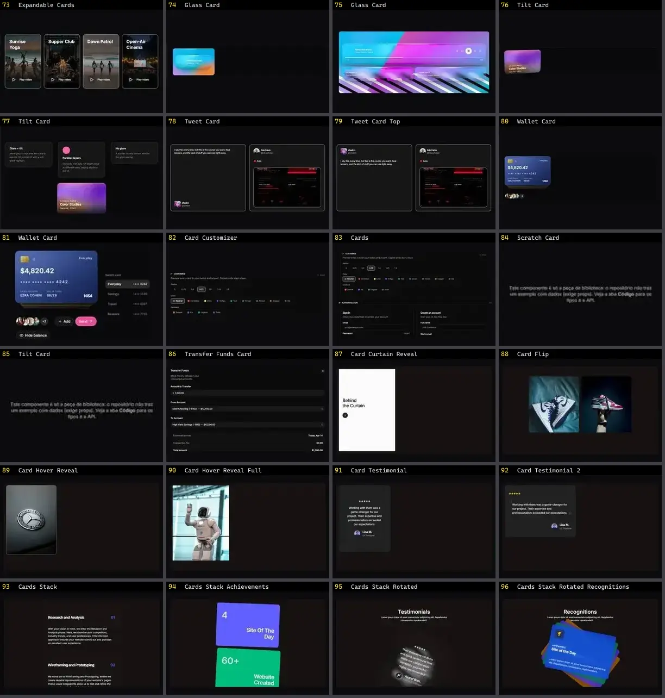

# Card — folha 4

| nº | nome | uid | tipo de aplicação |
|---|---|---|---|
| 73 | Expandable Cards | `smoothui:expandable-cards` | UI base |
| 74 | Glass Card | `smoothui:canvas/glass-card` | UI base |
| 75 | Glass Card | `smoothui:glass-card` | UI base |
| 76 | Tilt Card | `smoothui:canvas/tilt-card` | UI base |
| 77 | Tilt Card | `smoothui:tilt-card` | UI base |
| 78 | Tweet Card | `smoothui:tweet-card` | UI base |
| 79 | Tweet Card Top | `smoothui:tweet-card-top` | UI base |
| 80 | Wallet Card | `smoothui:canvas/wallet-card` | UI base |
| 81 | Wallet Card | `smoothui:wallet-card` | UI base |
| 82 | Card Customizer | `spectrumui:card-customizer` | UI base |
| 83 | Cards | `spectrumui:cards` | UI base |
| 84 | Scratch Card | `spectrumui:scratch-card` | UI base |
| 85 | Tilt Card | `spectrumui:tilt-card` | UI base |
| 86 | Transfer Funds Card | `spectrumui:transfer-funds-card` | UI base |
| 87 | Card Curtain Reveal | `systaliko:cards/card-curtain-reveal` | UI base |
| 88 | Card Flip | `systaliko:cards/card-flip` | UI base |
| 89 | Card Hover Reveal | `systaliko:cards/card-hover-reveal` | UI base |
| 90 | Card Hover Reveal Full | `systaliko:cards/card-hover-reveal-full` | UI base |
| 91 | Card Testimonial | `systaliko:cards/card-testimonial` | UI base |
| 92 | Card Testimonial 2 | `systaliko:cards/card-testimonial-2` | UI base |
| 93 | Cards Stack | `systaliko:cards/cards-stack` | UI base |
| 94 | Cards Stack Achievements | `systaliko:cards/cards-stack-achievements` | UI base |
| 95 | Cards Stack Rotated | `systaliko:cards/cards-stack-rotated` | UI base |
| 96 | Cards Stack Rotated Recognitions | `systaliko:cards/cards-stack-rotated-recognitions` | UI base |
