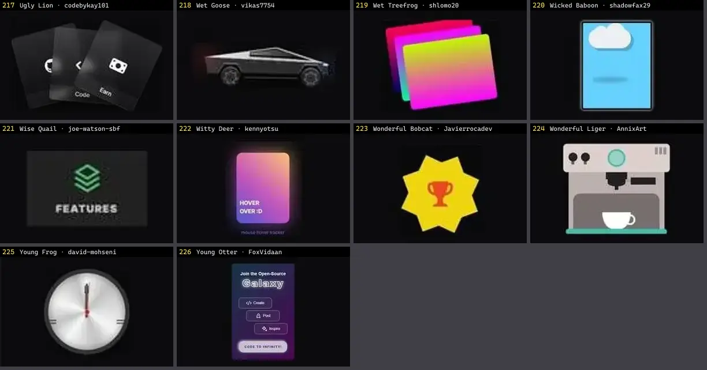

# Card — folha 10

| nº | nome | uid | tipo de aplicação |
|---|---|---|---|
| 217 | Tasty Dodo · elijahgummer | `uiverse:Cards/elijahgummer_tasty-dodo-72` | UI base |
| 218 | Tasty Falcon · kennyotsu | `uiverse:Cards/kennyotsu_tasty-falcon-38` | UI base |
| 219 | Terrible Hound · Hoseinnaqvi | `uiverse:Cards/Hoseinnaqvi_terrible-hound-31` | UI base |
| 220 | Tidy Mole · sangmort | `uiverse:Cards/sangmort_tidy-mole-17` | UI base |
| 221 | Tiny Firefox · csemszepp | `uiverse:Cards/csemszepp_tiny-firefox-14` | UI base |
| 222 | Tough Fireant · Javierrocadev | `uiverse:Cards/Javierrocadev_tough-fireant-65` | UI base |
| 223 | Tough Impala · RozheenNM | `uiverse:Cards/RozheenNM_tough-impala-7` | UI base |
| 224 | Tricky Lionfish · Smit-Prajapati | `uiverse:Cards/Smit-Prajapati_tricky-lionfish-78` | UI base |
| 225 | Tricky Robin · ElSombrero2 | `uiverse:Cards/ElSombrero2_tricky-robin-67` | UI base |
| 226 | Ugly Horse · sohoning | `uiverse:Cards/sohoning_ugly-horse-87` | UI base |
| 227 | Ugly Lion · codebykay101 | `uiverse:Cards/codebykay101_ugly-lion-23` | UI base |
| 228 | Wet Goose · vikas7754 | `uiverse:Cards/vikas7754_wet-goose-61` | UI base |
| 229 | Wet Treefrog · shlomo20 | `uiverse:Cards/shlomo20_wet-treefrog-28` | UI base |
| 230 | Wicked Baboon · shadowfax29 | `uiverse:Cards/shadowfax29_wicked-baboon-62` | UI base |
| 231 | Wise Quail · joe-watson-sbf | `uiverse:Cards/joe-watson-sbf_wise-quail-35` | UI base |
| 232 | Witty Deer · kennyotsu | `uiverse:Cards/kennyotsu_witty-deer-12` | UI base |
| 233 | Wonderful Bobcat · Javierrocadev | `uiverse:Cards/Javierrocadev_wonderful-bobcat-57` | UI base |
| 234 | Wonderful Liger · AnnixArt | `uiverse:Cards/AnnixArt_wonderful-liger-82` | UI base |
| 235 | Young Frog · david-mohseni | `uiverse:Cards/david-mohseni_young-frog-89` | UI base |
| 236 | Young Otter · FoxVidaan | `uiverse:Cards/FoxVidaan_young-otter-32` | UI base |
