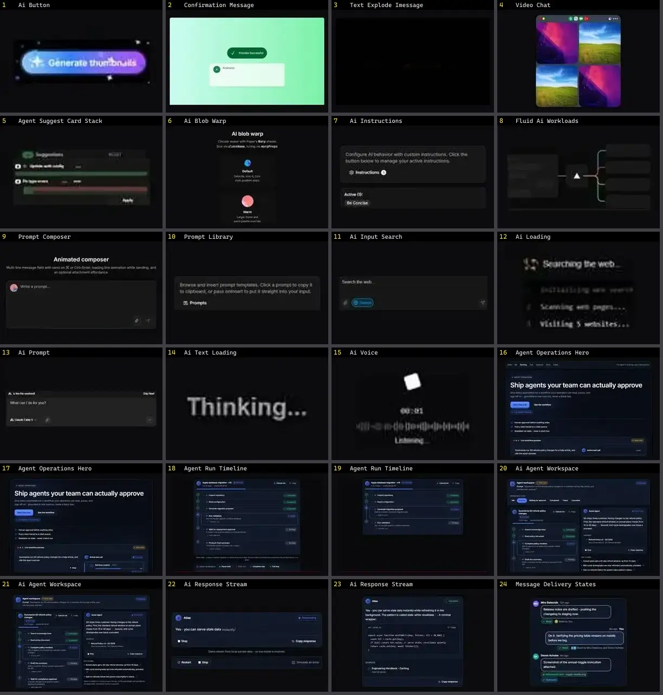

# Chat & IA — folha 1

| nº | nome | uid | tipo de aplicação |
|---|---|---|---|
| 1 | Ai Button | `animata:button/ai-button` | IA & Chat |
| 2 | Confirmation Message | `animata:feature-cards/confirmation-message` | IA & Chat |
| 3 | Text Explode Imessage | `animata:text/text-explode-imessage` | IA & Chat |
| 4 | Video Chat | `animata:widget/video-chat` | IA & Chat |
| 5 | Agent Suggest Card Stack | `cultui:agent-suggest-card-stack-demo` | IA & Chat |
| 6 | Ai Blob Warp | `cultui:ai-blob-warp-demo` | IA & Chat |
| 7 | Ai Instructions | `cultui:ai-instructions-demo` | IA & Chat |
| 8 | Fluid Ai Workloads | `cultui:fluid-ai-workloads-demo` | IA & Chat |
| 9 | Prompt Composer | `cultui:prompt-composer-demo` | IA & Chat |
| 10 | Prompt Library | `cultui:prompt-library-demo` | IA & Chat |
| 11 | Ai Input Search | `kokonutui:ai-input-search` | IA & Chat |
| 12 | Ai Loading | `kokonutui:ai-loading` | IA & Chat |
| 13 | Ai Prompt | `kokonutui:ai-prompt` | IA & Chat |
| 14 | Ai Text Loading | `kokonutui:ai-text-loading` | IA & Chat |
| 15 | Ai Voice | `kokonutui:ai-voice` | IA & Chat |
| 16 | Agent Operations Hero | `motiq:agent-operations-hero` | IA & Chat |
| 17 | Agent Operations Hero | `motiq:catalog/agent-operations-hero` | IA & Chat |
| 18 | Agent Run Timeline | `motiq:agent-run-timeline` | IA & Chat |
| 19 | Agent Run Timeline | `motiq:catalog/agent-run-timeline` | IA & Chat |
| 20 | Ai Agent Workspace | `motiq:ai-agent-workspace` | IA & Chat |
| 21 | Ai Agent Workspace | `motiq:catalog/ai-agent-workspace` | IA & Chat |
| 22 | Ai Response Stream | `motiq:ai-response-stream` | IA & Chat |
| 23 | Ai Response Stream | `motiq:catalog/ai-response-stream` | IA & Chat |
| 24 | Message Delivery States | `motiq:catalog/message-delivery-states` | IA & Chat |
