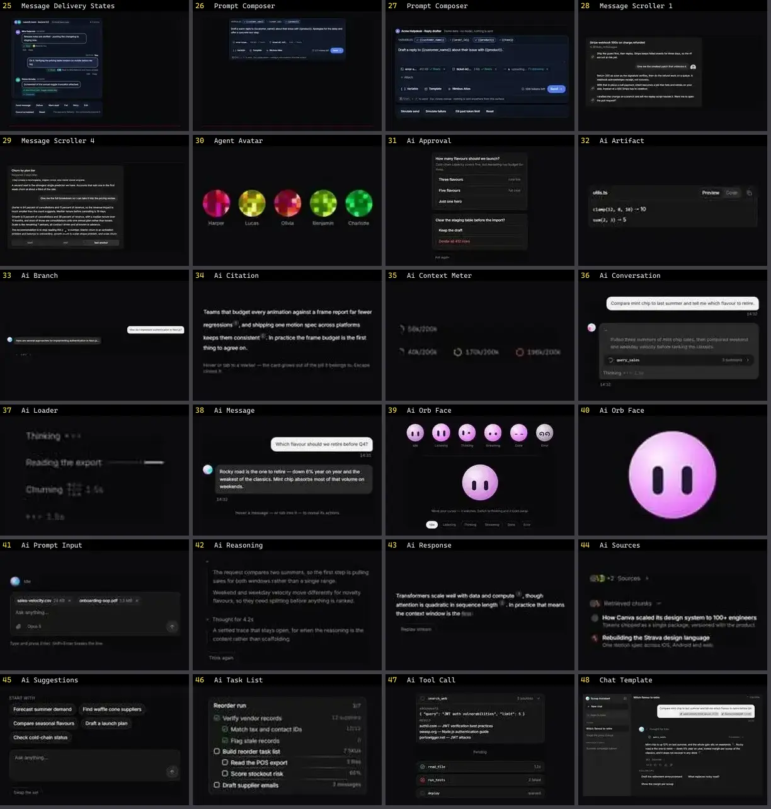

# Chat & IA — folha 2

| nº | nome | uid | tipo de aplicação |
|---|---|---|---|
| 25 | Message Delivery States | `motiq:message-delivery-states` | IA & Chat |
| 26 | Prompt Composer | `motiq:catalog/prompt-composer` | IA & Chat |
| 27 | Prompt Composer | `motiq:prompt-composer` | IA & Chat |
| 28 | Message Scroller 1 | `reui:message-scroller/c-message-scroller-1` | IA & Chat |
| 29 | Message Scroller 4 | `reui:message-scroller/c-message-scroller-4` | IA & Chat |
| 30 | Agent Avatar | `smoothui:agent-avatar` | IA & Chat |
| 31 | Ai Approval | `smoothui:ai-approval` | IA & Chat |
| 32 | Ai Artifact | `smoothui:ai-artifact` | IA & Chat |
| 33 | Ai Branch | `smoothui:ai-branch` | IA & Chat |
| 34 | Ai Citation | `smoothui:ai-citation` | IA & Chat |
| 35 | Ai Context Meter | `smoothui:ai-context-meter` | IA & Chat |
| 36 | Ai Conversation | `smoothui:ai-conversation` | IA & Chat |
| 37 | Ai Loader | `smoothui:ai-loader` | IA & Chat |
| 38 | Ai Message | `smoothui:ai-message` | IA & Chat |
| 39 | Ai Orb Face | `smoothui:ai-orb-face` | IA & Chat |
| 40 | Ai Orb Face | `smoothui:canvas/ai-orb-face` | IA & Chat |
| 41 | Ai Prompt Input | `smoothui:ai-prompt-input` | IA & Chat |
| 42 | Ai Reasoning | `smoothui:ai-reasoning` | IA & Chat |
| 43 | Ai Response | `smoothui:ai-response` | IA & Chat |
| 44 | Ai Sources | `smoothui:ai-sources` | IA & Chat |
| 45 | Ai Suggestions | `smoothui:ai-suggestions` | IA & Chat |
| 46 | Ai Task List | `smoothui:ai-task-list` | IA & Chat |
| 47 | Ai Tool Call | `smoothui:ai-tool-call` | IA & Chat |
| 48 | Chat Template | `smoothui:chat-template` | IA & Chat |
