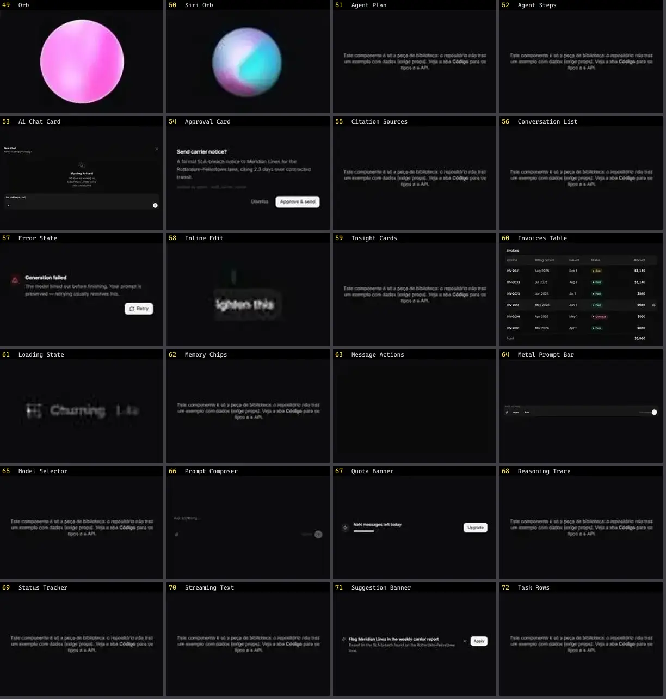

# Chat & IA — folha 3

| nº | nome | uid | tipo de aplicação |
|---|---|---|---|
| 49 | Orb | `smoothui:orb` | IA & Chat |
| 50 | Siri Orb | `smoothui:siri-orb` | IA & Chat |
| 51 | Agent Plan | `spectrumui:blocks/ai-assistants/agent-plan` | IA & Chat |
| 52 | Agent Steps | `spectrumui:blocks/ai-assistants/agent-steps` | IA & Chat |
| 53 | Ai Chat Card | `spectrumui:ai-chat-card` | IA & Chat |
| 54 | Approval Card | `spectrumui:blocks/ai-assistants/approval-card` | IA & Chat |
| 55 | Citation Sources | `spectrumui:blocks/ai-assistants/citation-sources` | IA & Chat |
| 56 | Conversation List | `spectrumui:blocks/ai-assistants/conversation-list` | IA & Chat |
| 57 | Error State | `spectrumui:blocks/ai-assistants/error-state` | IA & Chat |
| 58 | Inline Edit | `spectrumui:blocks/ai-assistants/inline-edit` | IA & Chat |
| 59 | Insight Cards | `spectrumui:blocks/ai-assistants/insight-cards` | IA & Chat |
| 60 | Invoices Table | `spectrumui:blocks/tables/invoices-table` | IA & Chat |
| 61 | Loading State | `spectrumui:blocks/ai-assistants/loading-state` | IA & Chat |
| 62 | Memory Chips | `spectrumui:blocks/ai-assistants/memory-chips` | IA & Chat |
| 63 | Message Actions | `spectrumui:blocks/ai-assistants/message-actions` | IA & Chat |
| 64 | Metal Prompt Bar | `spectrumui:metal-prompt-bar` | IA & Chat |
| 65 | Model Selector | `spectrumui:blocks/ai-assistants/model-selector` | IA & Chat |
| 66 | Prompt Composer | `spectrumui:blocks/ai-assistants/prompt-composer` | IA & Chat |
| 67 | Quota Banner | `spectrumui:blocks/ai-assistants/quota-banner` | IA & Chat |
| 68 | Reasoning Trace | `spectrumui:blocks/ai-assistants/reasoning-trace` | IA & Chat |
| 69 | Status Tracker | `spectrumui:blocks/ai-assistants/status-tracker` | IA & Chat |
| 70 | Streaming Text | `spectrumui:blocks/ai-assistants/streaming-text` | IA & Chat |
| 71 | Suggestion Banner | `spectrumui:blocks/ai-assistants/suggestion-banner` | IA & Chat |
| 72 | Task Rows | `spectrumui:blocks/ai-assistants/task-rows` | IA & Chat |
