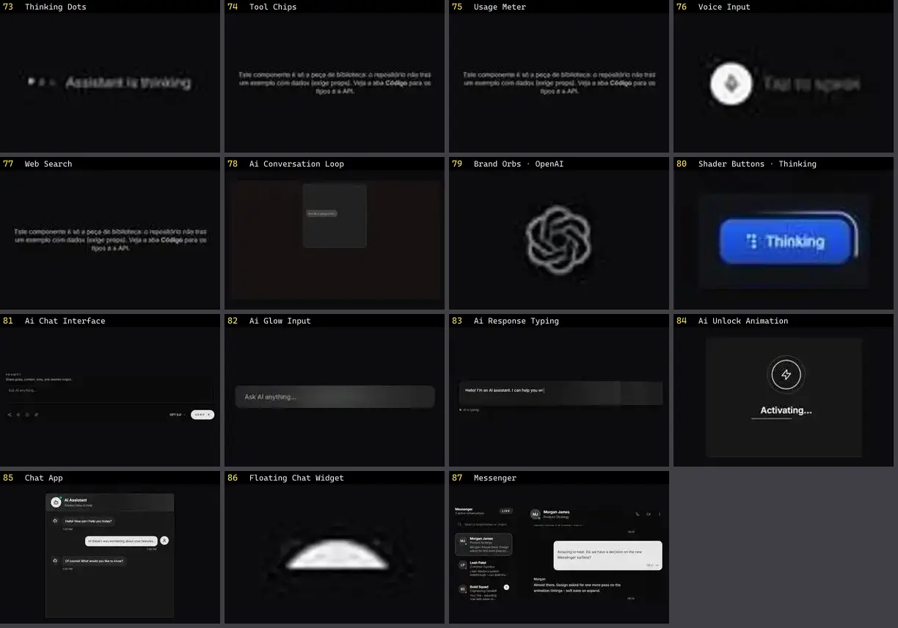

# Chat & IA — folha 4

| nº | nome | uid | tipo de aplicação |
|---|---|---|---|
| 73 | Thinking Dots | `spectrumui:blocks/ai-assistants/thinking-dots` | IA & Chat |
| 74 | Tool Chips | `spectrumui:blocks/ai-assistants/tool-chips` | IA & Chat |
| 75 | Usage Meter | `spectrumui:blocks/ai-assistants/usage-meter` | IA & Chat |
| 76 | Voice Input | `spectrumui:blocks/ai-assistants/voice-input` | IA & Chat |
| 77 | Web Search | `spectrumui:blocks/ai-assistants/web-search` | IA & Chat |
| 78 | Ai Conversation Loop | `systaliko:blocks/ai-conversation-loop` | IA & Chat |
| 79 | Brand Orbs · OpenAI | `threeui:brand-orbs/openai` | IA & Chat |
| 80 | Shader Buttons · Thinking | `threeui:star-portal/thinking-button` | IA & Chat |
| 81 | Ai Chat Interface | `uitripled:components/chat/ai-chat-interface` | IA & Chat |
| 82 | Ai Glow Input | `uitripled:motion-core/ai-glow-input` | IA & Chat |
| 83 | Ai Response Typing | `uitripled:motion-core/ai-response-typing` | IA & Chat |
| 84 | Ai Unlock Animation | `uitripled:motion-core/ai-unlock-animation` | IA & Chat |
| 85 | Chat App | `uitripled:components/chat/chat-app` | IA & Chat |
| 86 | Floating Chat Widget | `uitripled:components/chat/floating-chat-widget` | IA & Chat |
| 87 | Messenger | `uitripled:components/chat/messenger` | IA & Chat |
