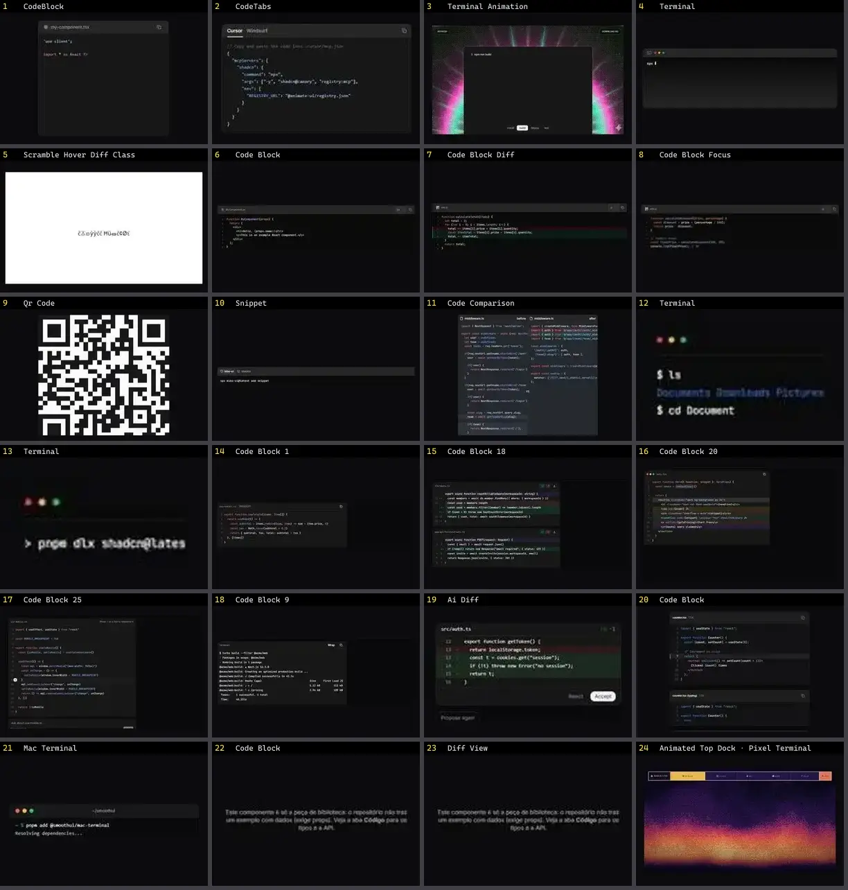

# Código & Terminal — folha 1

| nº | nome | uid | tipo de aplicação |
|---|---|---|---|
| 1 | CodeBlock | `atlas:Text/CodeBlock` | Docs & Dev tools |
| 2 | CodeTabs | `atlas:Misc/CodeTabs` | Docs & Dev tools |
| 3 | Terminal Animation | `cultui:terminal-animation-demo` | Docs & Dev tools |
| 4 | Terminal | `eldoraui:terminal-demo` | Docs & Dev tools |
| 5 | Scramble Hover Diff Class | `fancy:text/scramble-hover-diff-class-demo` | Docs & Dev tools |
| 6 | Code Block | `kibo:code-block` | Docs & Dev tools |
| 7 | Code Block Diff | `kibo:code-block-diff` | Docs & Dev tools |
| 8 | Code Block Focus | `kibo:code-block-focus` | Docs & Dev tools |
| 9 | Qr Code | `kibo:qr-code` | Docs & Dev tools |
| 10 | Snippet | `kibo:snippet` | Docs & Dev tools |
| 11 | Code Comparison | `magicui:code-comparison-demo` | Docs & Dev tools |
| 12 | Terminal | `magicui:terminal-demo-2` | Docs & Dev tools |
| 13 | Terminal | `magicui:terminal-demo` | Docs & Dev tools |
| 14 | Code Block 1 | `reui:code-block/c-code-block-1` | Docs & Dev tools |
| 15 | Code Block 18 | `reui:code-block/c-code-block-18` | Docs & Dev tools |
| 16 | Code Block 20 | `reui:code-block/c-code-block-20` | Docs & Dev tools |
| 17 | Code Block 25 | `reui:code-block/c-code-block-25` | Docs & Dev tools |
| 18 | Code Block 9 | `reui:code-block/c-code-block-9` | Docs & Dev tools |
| 19 | Ai Diff | `smoothui:ai-diff` | Docs & Dev tools |
| 20 | Code Block | `smoothui:code-block` | Docs & Dev tools |
| 21 | Mac Terminal | `smoothui:mac-terminal` | Docs & Dev tools |
| 22 | Code Block | `spectrumui:blocks/ai-assistants/code-block` | Docs & Dev tools |
| 23 | Diff View | `spectrumui:blocks/ai-assistants/diff-view` | Docs & Dev tools |
| 24 | Animated Top Dock · Pixel Terminal | `threeui:animated-top-dock/retro` | Docs & Dev tools |
