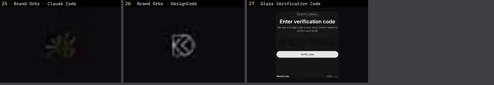

# Código & Terminal — folha 2

| nº | nome | uid | tipo de aplicação |
|---|---|---|---|
| 25 | Brand Orbs · Claude Code | `threeui:brand-orbs/claude` | Docs & Dev tools |
| 26 | Brand Orbs · DesignCode | `threeui:brand-orbs/designcode` | Docs & Dev tools |
| 27 | Glass Verification Code | `uitripled:components/forms/glass-verification-code` | Docs & Dev tools |
