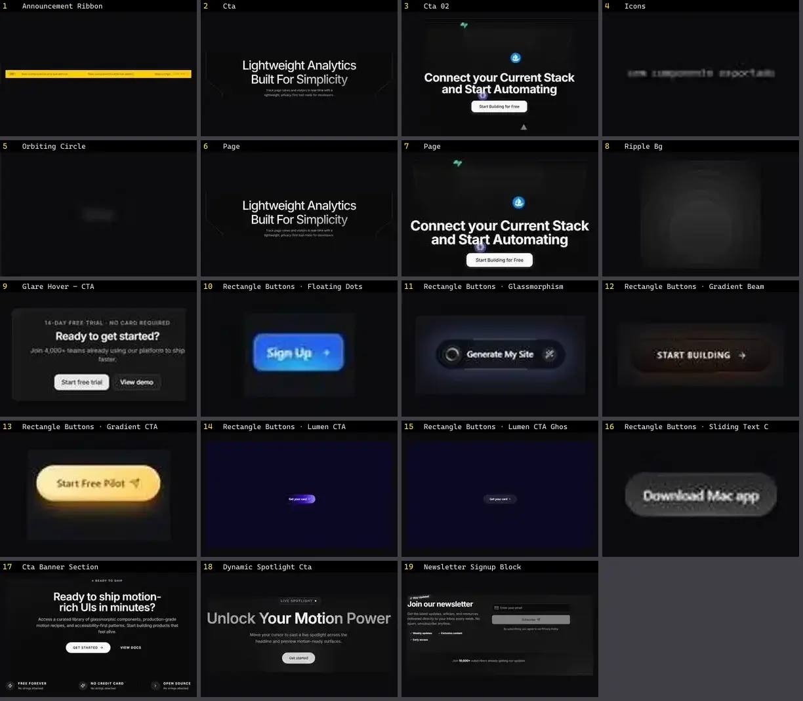

# CTA & Banner — folha 1

| nº | nome | uid | tipo de aplicação |
|---|---|---|---|
| 1 | Announcement Ribbon | `animata:container/announcement-ribbon` | Landing & Marketing |
| 2 | Cta | `eldoraui:cta-01/components/cta` | Landing & Marketing |
| 3 | Cta 02 | `eldoraui:cta-02/components/cta-02` | Landing & Marketing |
| 4 | Icons | `eldoraui:cta-02/components/icons` | Landing & Marketing |
| 5 | Orbiting Circle | `eldoraui:cta-02/components/orbiting-circle` | Landing & Marketing |
| 6 | Page | `eldoraui:cta-01/page` | Landing & Marketing |
| 7 | Page | `eldoraui:cta-02/page` | Landing & Marketing |
| 8 | Ripple Bg | `eldoraui:cta-03/components/ripple-bg` | Landing & Marketing |
| 9 | Glare Hover — CTA | `magicui:glare-hover-demo-cta` | Landing & Marketing |
| 10 | Rectangle Buttons · Floating Dots CTA | `threeui:rectangle-buttons/floating-dots-cta` | Landing & Marketing |
| 11 | Rectangle Buttons · Glassmorphism CTA | `threeui:rectangle-buttons/glassmorphism-cta` | Landing & Marketing |
| 12 | Rectangle Buttons · Gradient Beam CTA | `threeui:rectangle-buttons/gradient-beam-cta` | Landing & Marketing |
| 13 | Rectangle Buttons · Gradient CTA | `threeui:rectangle-buttons/gradient-cta` | Landing & Marketing |
| 14 | Rectangle Buttons · Lumen CTA | `threeui:rectangle-buttons/lumen-cta` | Landing & Marketing |
| 15 | Rectangle Buttons · Lumen CTA Ghost | `threeui:rectangle-buttons/lumen-cta-ghost` | Landing & Marketing |
| 16 | Rectangle Buttons · Sliding Text CTA | `threeui:rectangle-buttons/sliding-text-cta` | Landing & Marketing |
| 17 | Cta Banner Section | `uitripled:sections/cta-banner-section` | Landing & Marketing |
| 18 | Dynamic Spotlight Cta | `uitripled:motion-core/dynamic-spotlight-cta` | Landing & Marketing |
| 19 | Newsletter Signup Block | `uitripled:sections/newsletter-signup-block` | Landing & Marketing |
