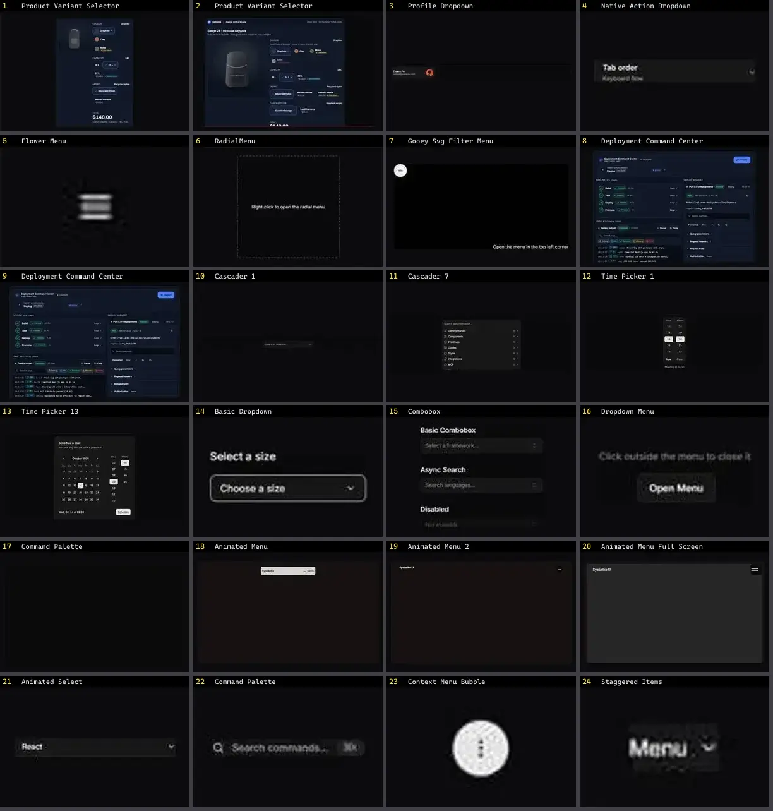

# Dropdown & Menu — folha 1

| nº | nome | uid | tipo de aplicação |
|---|---|---|---|
| 1 | Product Variant Selector | `motiq:catalog/product-variant-selector` | E-commerce |
| 2 | Product Variant Selector | `motiq:product-variant-selector` | E-commerce |
| 3 | Profile Dropdown | `kokonutui:profile-dropdown` | Login & Conta |
| 4 | Native Action Dropdown | `uitripled:native/demo/native-action-dropdown-demo` | Mobile & App |
| 5 | Flower Menu | `animata:fabs/flower-menu` | UI base |
| 6 | RadialMenu | `atlas:Menus/RadialMenu` | UI base |
| 7 | Gooey Svg Filter Menu | `fancy:filter/gooey-svg-filter-menu-demo` | UI base |
| 8 | Deployment Command Center | `motiq:catalog/deployment-command-center` | UI base |
| 9 | Deployment Command Center | `motiq:deployment-command-center` | UI base |
| 10 | Cascader 1 | `reui:cascader/c-cascader-1` | UI base |
| 11 | Cascader 7 | `reui:cascader/c-cascader-7` | UI base |
| 12 | Time Picker 1 | `reui:time-picker/c-time-picker-1` | UI base |
| 13 | Time Picker 13 | `reui:time-picker/c-time-picker-13` | UI base |
| 14 | Basic Dropdown | `smoothui:basic-dropdown` | UI base |
| 15 | Combobox | `smoothui:combobox` | UI base |
| 16 | Dropdown Menu | `smoothui:dropdown-menu` | UI base |
| 17 | Command Palette | `spectrumui:command-palette` | UI base |
| 18 | Animated Menu | `systaliko:blocks/animated-menu` | UI base |
| 19 | Animated Menu 2 | `systaliko:blocks/animated-menu-2` | UI base |
| 20 | Animated Menu Full Screen | `systaliko:blocks/animated-menu-full-screen` | UI base |
| 21 | Animated Select | `uitripled:forms/animated-select` | UI base |
| 22 | Command Palette | `uitripled:search/command-palette` | UI base |
| 23 | Context Menu Bubble | `uitripled:motion-core/context-menu-bubble` | UI base |
| 24 | Staggered Items | `uitripled:components/dropdown/staggered-items` | UI base |
