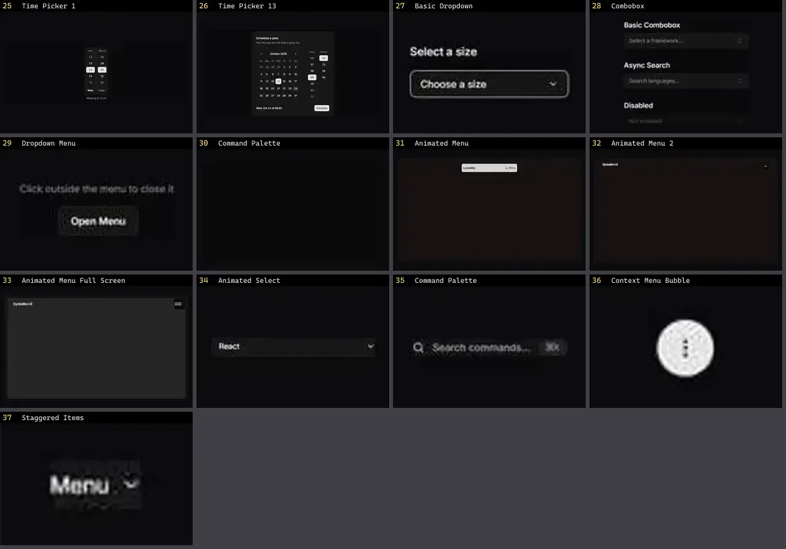

# Dropdown & Menu — folha 2

| nº | nome | uid | tipo de aplicação |
|---|---|---|---|
| 25 | Time Picker 1 | `reui:time-picker/c-time-picker-1` | UI base |
| 26 | Time Picker 13 | `reui:time-picker/c-time-picker-13` | UI base |
| 27 | Basic Dropdown | `smoothui:basic-dropdown` | UI base |
| 28 | Combobox | `smoothui:combobox` | UI base |
| 29 | Dropdown Menu | `smoothui:dropdown-menu` | UI base |
| 30 | Command Palette | `spectrumui:command-palette` | UI base |
| 31 | Animated Menu | `systaliko:blocks/animated-menu` | UI base |
| 32 | Animated Menu 2 | `systaliko:blocks/animated-menu-2` | UI base |
| 33 | Animated Menu Full Screen | `systaliko:blocks/animated-menu-full-screen` | UI base |
| 34 | Animated Select | `uitripled:forms/animated-select` | UI base |
| 35 | Command Palette | `uitripled:search/command-palette` | UI base |
| 36 | Context Menu Bubble | `uitripled:motion-core/context-menu-bubble` | UI base |
| 37 | Staggered Items | `uitripled:components/dropdown/staggered-items` | UI base |
