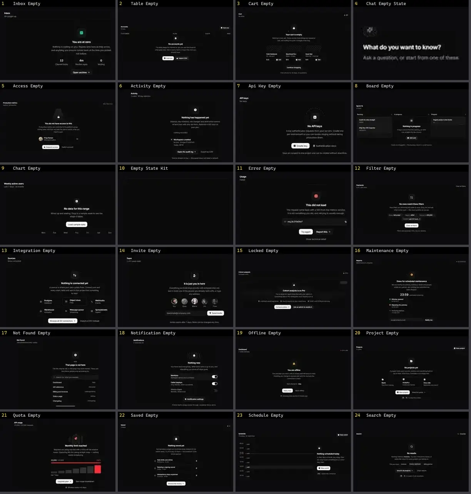

# Estado vazio — folha 1

| nº | nome | uid | tipo de aplicação |
|---|---|---|---|
| 1 | Inbox Empty | `spectrumui:blocks/empty-states/inbox-empty` | Dashboard & Admin |
| 2 | Table Empty | `spectrumui:blocks/empty-states/table-empty` | Dashboard & Admin |
| 3 | Cart Empty | `spectrumui:blocks/empty-states/cart-empty` | E-commerce |
| 4 | Chat Empty State | `spectrumui:blocks/ai-assistants/chat-empty-state` | IA & Chat |
| 5 | Access Empty | `spectrumui:blocks/empty-states/access-empty` | UI base |
| 6 | Activity Empty | `spectrumui:blocks/empty-states/activity-empty` | UI base |
| 7 | Api Key Empty | `spectrumui:blocks/empty-states/api-key-empty` | UI base |
| 8 | Board Empty | `spectrumui:blocks/empty-states/board-empty` | UI base |
| 9 | Chart Empty | `spectrumui:blocks/empty-states/chart-empty` | UI base |
| 10 | Empty State Kit | `spectrumui:blocks/empty-states/empty-state-kit` | UI base |
| 11 | Error Empty | `spectrumui:blocks/empty-states/error-empty` | UI base |
| 12 | Filter Empty | `spectrumui:blocks/empty-states/filter-empty` | UI base |
| 13 | Integration Empty | `spectrumui:blocks/empty-states/integration-empty` | UI base |
| 14 | Invite Empty | `spectrumui:blocks/empty-states/invite-empty` | UI base |
| 15 | Locked Empty | `spectrumui:blocks/empty-states/locked-empty` | UI base |
| 16 | Maintenance Empty | `spectrumui:blocks/empty-states/maintenance-empty` | UI base |
| 17 | Not Found Empty | `spectrumui:blocks/empty-states/not-found-empty` | UI base |
| 18 | Notification Empty | `spectrumui:blocks/empty-states/notification-empty` | UI base |
| 19 | Offline Empty | `spectrumui:blocks/empty-states/offline-empty` | UI base |
| 20 | Project Empty | `spectrumui:blocks/empty-states/project-empty` | UI base |
| 21 | Quota Empty | `spectrumui:blocks/empty-states/quota-empty` | UI base |
| 22 | Saved Empty | `spectrumui:blocks/empty-states/saved-empty` | UI base |
| 23 | Schedule Empty | `spectrumui:blocks/empty-states/schedule-empty` | UI base |
| 24 | Search Empty | `spectrumui:blocks/empty-states/search-empty` | UI base |
