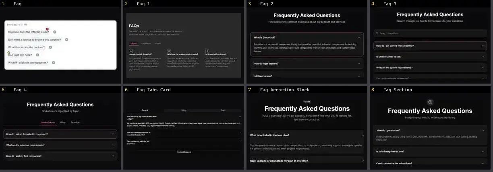

# FAQ — folha 1

| nº | nome | uid | tipo de aplicação |
|---|---|---|---|
| 1 | Faq | `animata:accordion/faq` | Landing & Marketing |
| 2 | Faq 1 | `smoothui:faq-1` | Landing & Marketing |
| 3 | Faq 2 | `smoothui:faq-2` | Landing & Marketing |
| 4 | Faq 3 | `smoothui:faq-3` | Landing & Marketing |
| 5 | Faq 4 | `smoothui:faq-4` | Landing & Marketing |
| 6 | Faq Tabs Card | `spectrumui:faq-tabs-card` | Landing & Marketing |
| 7 | Faq Accordion Block | `uitripled:sections/faq-accordion-block` | Landing & Marketing |
| 8 | Faq Section | `uitripled:sections/faq-section` | Landing & Marketing |
