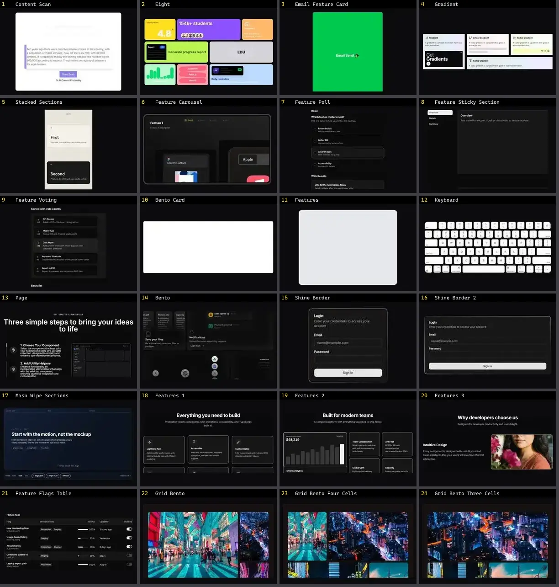

# Features & Bento — folha 1

| nº | nome | uid | tipo de aplicação |
|---|---|---|---|
| 1 | Content Scan | `animata:feature-cards/content-scan` | Landing & Marketing |
| 2 | Eight | `animata:bento-grid/eight` | Landing & Marketing |
| 3 | Email Feature Card | `animata:card/email-feature-card` | Landing & Marketing |
| 4 | Gradient | `animata:bento-grid/gradient` | Landing & Marketing |
| 5 | Stacked Sections | `animata:scroll/stacked-sections` | Landing & Marketing |
| 6 | Feature Carousel | `cultui:feature-carousel-demo` | Landing & Marketing |
| 7 | Feature Poll | `cultui:feature-poll-demo` | Landing & Marketing |
| 8 | Feature Sticky Section | `cultui:feature-sticky-section-demo` | Landing & Marketing |
| 9 | Feature Voting | `cultui:feature-voting-demo` | Landing & Marketing |
| 10 | Bento Card | `eldoraui:bento-01/components/bento-card` | Landing & Marketing |
| 11 | Features | `eldoraui:features-01/components/features` | Landing & Marketing |
| 12 | Keyboard | `eldoraui:bento-01/components/keyboard` | Landing & Marketing |
| 13 | Page | `eldoraui:features-01/page` | Landing & Marketing |
| 14 | Bento | `magicui:bento-demo` | Landing & Marketing |
| 15 | Shine Border | `magicui:shine-border-demo` | Landing & Marketing |
| 16 | Shine Border 2 | `magicui:shine-border-demo-2` | Landing & Marketing |
| 17 | Mask Wipe Sections | `motiq:mask-wipe-sections` | Landing & Marketing |
| 18 | Features 1 | `smoothui:features-1` | Landing & Marketing |
| 19 | Features 2 | `smoothui:features-2` | Landing & Marketing |
| 20 | Features 3 | `smoothui:features-3` | Landing & Marketing |
| 21 | Feature Flags Table | `spectrumui:blocks/tables/feature-flags-table` | Landing & Marketing |
| 22 | Grid Bento | `systaliko:blocks/grid-bento` | Landing & Marketing |
| 23 | Grid Bento Four Cells | `systaliko:blocks/grid-bento-four-cells` | Landing & Marketing |
| 24 | Grid Bento Three Cells | `systaliko:blocks/grid-bento-three-cells` | Landing & Marketing |
