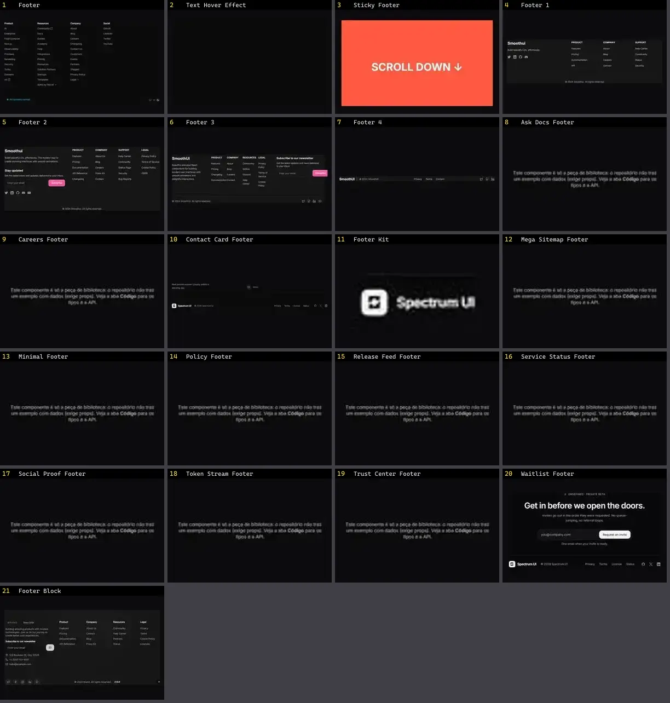

# Footer — folha 1

| nº | nome | uid | tipo de aplicação |
|---|---|---|---|
| 1 | Footer | `eldoraui:footer-01/components/footer` | Landing & Marketing |
| 2 | Text Hover Effect | `eldoraui:footer-01/components/text-hover-effect` | Landing & Marketing |
| 3 | Sticky Footer | `fancy:blocks/sticky-footer-demo` | Landing & Marketing |
| 4 | Footer 1 | `smoothui:footer-1` | Landing & Marketing |
| 5 | Footer 2 | `smoothui:footer-2` | Landing & Marketing |
| 6 | Footer 3 | `smoothui:footer-3` | Landing & Marketing |
| 7 | Footer 4 | `smoothui:footer-4` | Landing & Marketing |
| 8 | Ask Docs Footer | `spectrumui:blocks/footers/ask-docs-footer` | Landing & Marketing |
| 9 | Careers Footer | `spectrumui:blocks/footers/careers-footer` | Landing & Marketing |
| 10 | Contact Card Footer | `spectrumui:blocks/footers/contact-card-footer` | Landing & Marketing |
| 11 | Footer Kit | `spectrumui:blocks/footers/footer-kit` | Landing & Marketing |
| 12 | Mega Sitemap Footer | `spectrumui:blocks/footers/mega-sitemap-footer` | Landing & Marketing |
| 13 | Minimal Footer | `spectrumui:blocks/footers/minimal-footer` | Landing & Marketing |
| 14 | Policy Footer | `spectrumui:blocks/footers/policy-footer` | Landing & Marketing |
| 15 | Release Feed Footer | `spectrumui:blocks/footers/release-feed-footer` | Landing & Marketing |
| 16 | Service Status Footer | `spectrumui:blocks/footers/service-status-footer` | Landing & Marketing |
| 17 | Social Proof Footer | `spectrumui:blocks/footers/social-proof-footer` | Landing & Marketing |
| 18 | Token Stream Footer | `spectrumui:blocks/footers/token-stream-footer` | Landing & Marketing |
| 19 | Trust Center Footer | `spectrumui:blocks/footers/trust-center-footer` | Landing & Marketing |
| 20 | Waitlist Footer | `spectrumui:blocks/footers/waitlist-footer` | Landing & Marketing |
| 21 | Footer Block | `uitripled:sections/footer-block` | Landing & Marketing |
