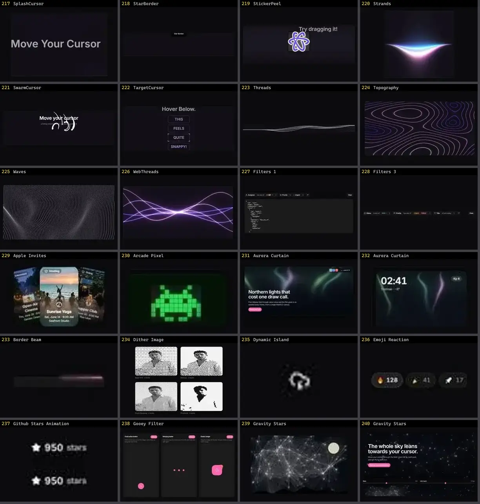

# Fundo & Efeito — folha 10

| nº | nome | uid | tipo de aplicação |
|---|---|---|---|
| 217 | SplashCursor | `reactbits:Animations/SplashCursorDemo` | Efeitos & Animação |
| 218 | StarBorder | `reactbits:Animations/StarBorderDemo` | Efeitos & Animação |
| 219 | StickerPeel | `reactbits:Animations/StickerPeelDemo` | Efeitos & Animação |
| 220 | Strands | `reactbits:Animations/StrandsDemo` | Efeitos & Animação |
| 221 | SwarmCursor | `reactbits:Animations/SwarmCursorDemo` | Efeitos & Animação |
| 222 | TargetCursor | `reactbits:Animations/TargetCursorDemo` | Efeitos & Animação |
| 223 | Threads | `reactbits:Backgrounds/ThreadsDemo` | Efeitos & Animação |
| 224 | Topography | `reactbits:Backgrounds/TopographyDemo` | Efeitos & Animação |
| 225 | Waves | `reactbits:Backgrounds/WavesDemo` | Efeitos & Animação |
| 226 | WebThreads | `reactbits:Backgrounds/WebThreadsDemo` | Efeitos & Animação |
| 227 | Filters 1 | `reui:filters/c-filters-1` | Efeitos & Animação |
| 228 | Filters 3 | `reui:filters/c-filters-3` | Efeitos & Animação |
| 229 | Apple Invites | `smoothui:canvas/apple-invites` | Efeitos & Animação |
| 230 | Arcade Pixel | `smoothui:canvas/arcade-pixel` | Efeitos & Animação |
| 231 | Aurora Curtain | `smoothui:aurora-curtain` | Efeitos & Animação |
| 232 | Aurora Curtain | `smoothui:canvas/aurora-curtain` | Efeitos & Animação |
| 233 | Border Beam | `smoothui:border-beam` | Efeitos & Animação |
| 234 | Dither Image | `smoothui:dither-image` | Efeitos & Animação |
| 235 | Dynamic Island | `smoothui:canvas/dynamic-island` | Efeitos & Animação |
| 236 | Emoji Reaction | `smoothui:canvas/emoji-reaction` | Efeitos & Animação |
| 237 | Github Stars Animation | `smoothui:github-stars-animation` | Efeitos & Animação |
| 238 | Gooey Filter | `smoothui:gooey-filter` | Efeitos & Animação |
| 239 | Gravity Stars | `smoothui:canvas/gravity-stars` | Efeitos & Animação |
| 240 | Gravity Stars | `smoothui:gravity-stars` | Efeitos & Animação |
