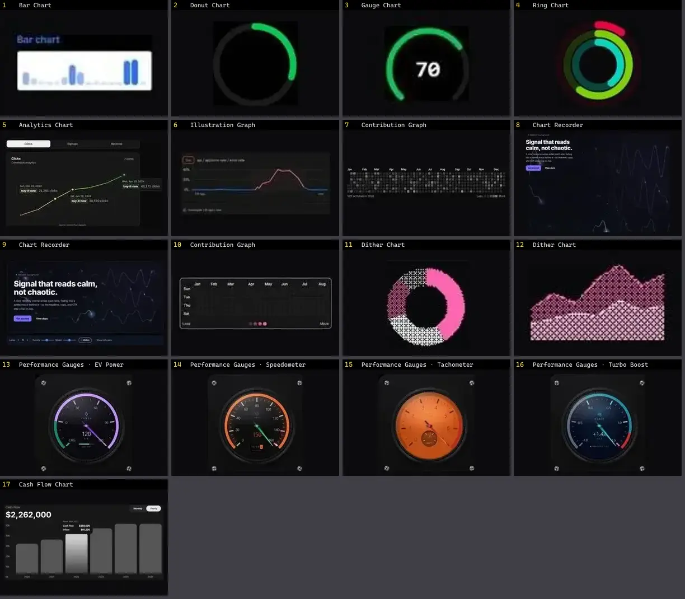

# Gráfico — folha 1

| nº | nome | uid | tipo de aplicação |
|---|---|---|---|
| 1 | Bar Chart | `animata:graphs/bar-chart` | Dashboard & Admin |
| 2 | Donut Chart | `animata:graphs/donut-chart` | Dashboard & Admin |
| 3 | Gauge Chart | `animata:graphs/gauge-chart` | Dashboard & Admin |
| 4 | Ring Chart | `animata:graphs/ring-chart` | Dashboard & Admin |
| 5 | Analytics Chart | `cultui:analytics-chart-demo` | Dashboard & Admin |
| 6 | Illustration Graph | `cultui:illustration-graph-demo` | Dashboard & Admin |
| 7 | Contribution Graph | `kibo:contribution-graph` | Dashboard & Admin |
| 8 | Chart Recorder | `motiq:catalog/chart-recorder` | Dashboard & Admin |
| 9 | Chart Recorder | `motiq:chart-recorder` | Dashboard & Admin |
| 10 | Contribution Graph | `smoothui:contribution-graph` | Dashboard & Admin |
| 11 | Dither Chart | `smoothui:canvas/dither-chart` | Dashboard & Admin |
| 12 | Dither Chart | `smoothui:dither-chart` | Dashboard & Admin |
| 13 | Performance Gauges · EV Power | `threeui:performance-gauges/power` | Dashboard & Admin |
| 14 | Performance Gauges · Speedometer | `threeui:performance-gauges/speedometer` | Dashboard & Admin |
| 15 | Performance Gauges · Tachometer | `threeui:performance-gauges/tachometer` | Dashboard & Admin |
| 16 | Performance Gauges · Turbo Boost | `threeui:performance-gauges/boost` | Dashboard & Admin |
| 17 | Cash Flow Chart | `uitripled:data/charts/cash-flow-chart` | Dashboard & Admin |
