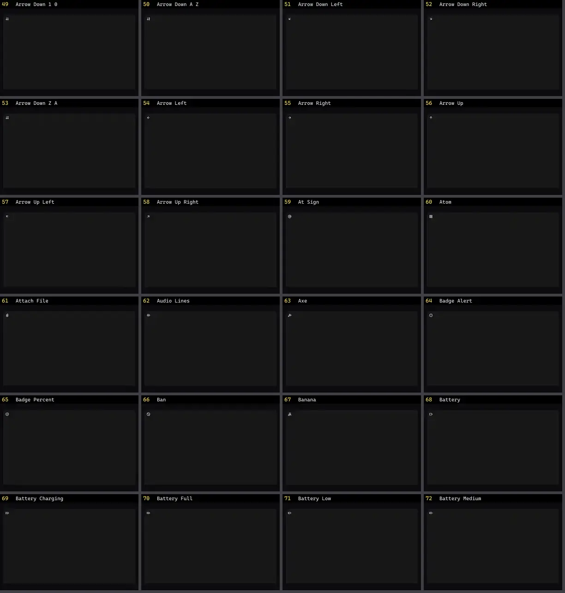

# Ícone — folha 3

| nº | nome | uid | tipo de aplicação |
|---|---|---|---|
| 49 | Arrow Down 1 0 | `lucideanimated:arrow-down-1-0` | UI base |
| 50 | Arrow Down A Z | `lucideanimated:arrow-down-a-z` | UI base |
| 51 | Arrow Down Left | `lucideanimated:arrow-down-left` | UI base |
| 52 | Arrow Down Right | `lucideanimated:arrow-down-right` | UI base |
| 53 | Arrow Down Z A | `lucideanimated:arrow-down-z-a` | UI base |
| 54 | Arrow Left | `lucideanimated:arrow-left` | UI base |
| 55 | Arrow Right | `lucideanimated:arrow-right` | UI base |
| 56 | Arrow Up | `lucideanimated:arrow-up` | UI base |
| 57 | Arrow Up Left | `lucideanimated:arrow-up-left` | UI base |
| 58 | Arrow Up Right | `lucideanimated:arrow-up-right` | UI base |
| 59 | At Sign | `lucideanimated:at-sign` | UI base |
| 60 | Atom | `lucideanimated:atom` | UI base |
| 61 | Attach File | `lucideanimated:attach-file` | UI base |
| 62 | Audio Lines | `lucideanimated:audio-lines` | UI base |
| 63 | Axe | `lucideanimated:axe` | UI base |
| 64 | Badge Alert | `lucideanimated:badge-alert` | UI base |
| 65 | Badge Percent | `lucideanimated:badge-percent` | UI base |
| 66 | Ban | `lucideanimated:ban` | UI base |
| 67 | Banana | `lucideanimated:banana` | UI base |
| 68 | Battery | `lucideanimated:battery` | UI base |
| 69 | Battery Charging | `lucideanimated:battery-charging` | UI base |
| 70 | Battery Full | `lucideanimated:battery-full` | UI base |
| 71 | Battery Low | `lucideanimated:battery-low` | UI base |
| 72 | Battery Medium | `lucideanimated:battery-medium` | UI base |
