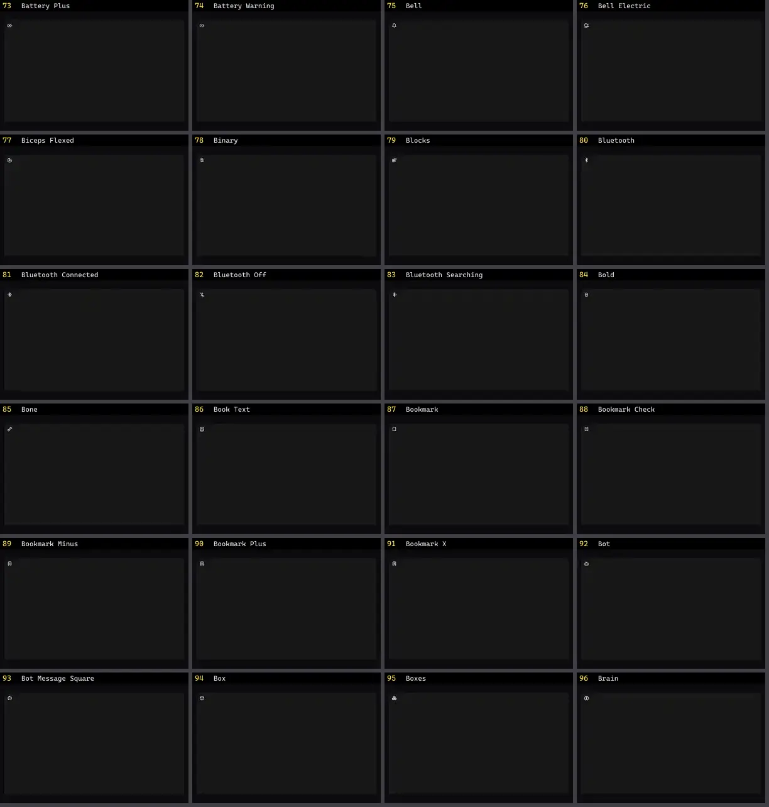

# Ícone — folha 4

| nº | nome | uid | tipo de aplicação |
|---|---|---|---|
| 73 | Battery Plus | `lucideanimated:battery-plus` | UI base |
| 74 | Battery Warning | `lucideanimated:battery-warning` | UI base |
| 75 | Bell | `lucideanimated:bell` | UI base |
| 76 | Bell Electric | `lucideanimated:bell-electric` | UI base |
| 77 | Biceps Flexed | `lucideanimated:biceps-flexed` | UI base |
| 78 | Binary | `lucideanimated:binary` | UI base |
| 79 | Blocks | `lucideanimated:blocks` | UI base |
| 80 | Bluetooth | `lucideanimated:bluetooth` | UI base |
| 81 | Bluetooth Connected | `lucideanimated:bluetooth-connected` | UI base |
| 82 | Bluetooth Off | `lucideanimated:bluetooth-off` | UI base |
| 83 | Bluetooth Searching | `lucideanimated:bluetooth-searching` | UI base |
| 84 | Bold | `lucideanimated:bold` | UI base |
| 85 | Bone | `lucideanimated:bone` | UI base |
| 86 | Book Text | `lucideanimated:book-text` | UI base |
| 87 | Bookmark | `lucideanimated:bookmark` | UI base |
| 88 | Bookmark Check | `lucideanimated:bookmark-check` | UI base |
| 89 | Bookmark Minus | `lucideanimated:bookmark-minus` | UI base |
| 90 | Bookmark Plus | `lucideanimated:bookmark-plus` | UI base |
| 91 | Bookmark X | `lucideanimated:bookmark-x` | UI base |
| 92 | Bot | `lucideanimated:bot` | UI base |
| 93 | Bot Message Square | `lucideanimated:bot-message-square` | UI base |
| 94 | Box | `lucideanimated:box` | UI base |
| 95 | Boxes | `lucideanimated:boxes` | UI base |
| 96 | Brain | `lucideanimated:brain` | UI base |
