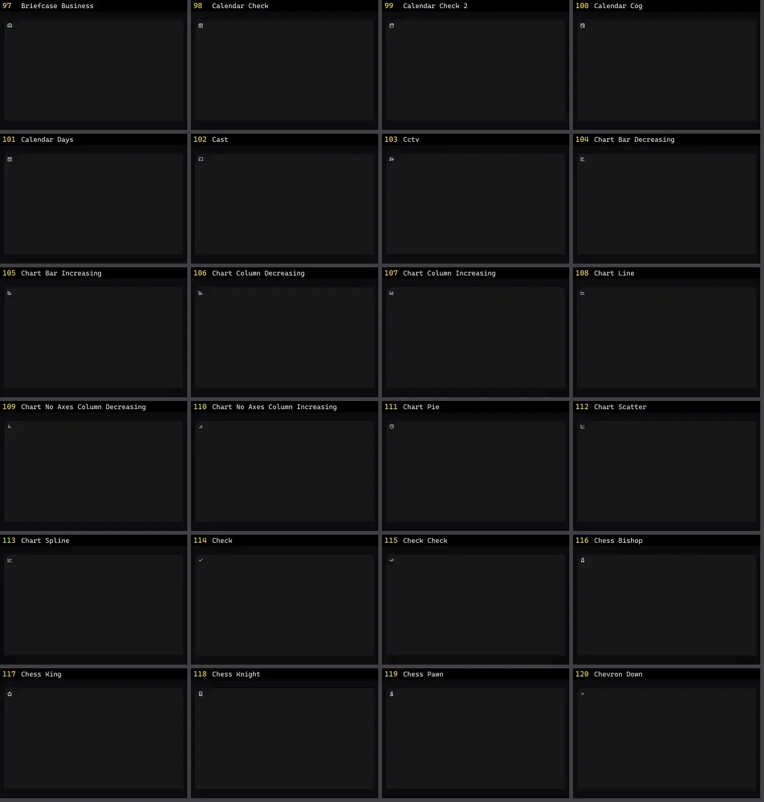

# Ícone — folha 5

| nº | nome | uid | tipo de aplicação |
|---|---|---|---|
| 97 | Briefcase Business | `lucideanimated:briefcase-business` | UI base |
| 98 | Calendar Check | `lucideanimated:calendar-check` | UI base |
| 99 | Calendar Check 2 | `lucideanimated:calendar-check-2` | UI base |
| 100 | Calendar Cog | `lucideanimated:calendar-cog` | UI base |
| 101 | Calendar Days | `lucideanimated:calendar-days` | UI base |
| 102 | Cast | `lucideanimated:cast` | UI base |
| 103 | Cctv | `lucideanimated:cctv` | UI base |
| 104 | Chart Bar Decreasing | `lucideanimated:chart-bar-decreasing` | UI base |
| 105 | Chart Bar Increasing | `lucideanimated:chart-bar-increasing` | UI base |
| 106 | Chart Column Decreasing | `lucideanimated:chart-column-decreasing` | UI base |
| 107 | Chart Column Increasing | `lucideanimated:chart-column-increasing` | UI base |
| 108 | Chart Line | `lucideanimated:chart-line` | UI base |
| 109 | Chart No Axes Column Decreasing | `lucideanimated:chart-no-axes-column-decreasing` | UI base |
| 110 | Chart No Axes Column Increasing | `lucideanimated:chart-no-axes-column-increasing` | UI base |
| 111 | Chart Pie | `lucideanimated:chart-pie` | UI base |
| 112 | Chart Scatter | `lucideanimated:chart-scatter` | UI base |
| 113 | Chart Spline | `lucideanimated:chart-spline` | UI base |
| 114 | Check | `lucideanimated:check` | UI base |
| 115 | Check Check | `lucideanimated:check-check` | UI base |
| 116 | Chess Bishop | `lucideanimated:chess-bishop` | UI base |
| 117 | Chess King | `lucideanimated:chess-king` | UI base |
| 118 | Chess Knight | `lucideanimated:chess-knight` | UI base |
| 119 | Chess Pawn | `lucideanimated:chess-pawn` | UI base |
| 120 | Chevron Down | `lucideanimated:chevron-down` | UI base |
