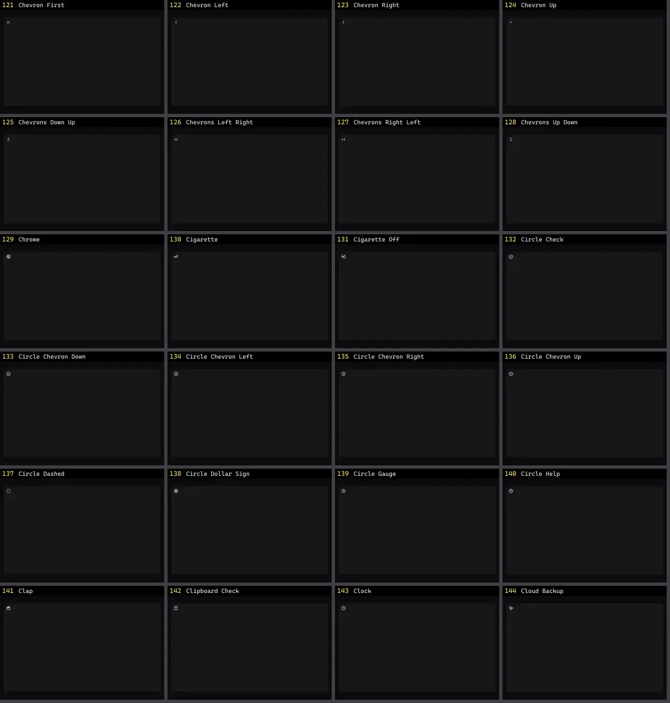

# Ícone — folha 6

| nº | nome | uid | tipo de aplicação |
|---|---|---|---|
| 121 | Chevron First | `lucideanimated:chevron-first` | UI base |
| 122 | Chevron Left | `lucideanimated:chevron-left` | UI base |
| 123 | Chevron Right | `lucideanimated:chevron-right` | UI base |
| 124 | Chevron Up | `lucideanimated:chevron-up` | UI base |
| 125 | Chevrons Down Up | `lucideanimated:chevrons-down-up` | UI base |
| 126 | Chevrons Left Right | `lucideanimated:chevrons-left-right` | UI base |
| 127 | Chevrons Right Left | `lucideanimated:chevrons-right-left` | UI base |
| 128 | Chevrons Up Down | `lucideanimated:chevrons-up-down` | UI base |
| 129 | Chrome | `lucideanimated:chrome` | UI base |
| 130 | Cigarette | `lucideanimated:cigarette` | UI base |
| 131 | Cigarette Off | `lucideanimated:cigarette-off` | UI base |
| 132 | Circle Check | `lucideanimated:circle-check` | UI base |
| 133 | Circle Chevron Down | `lucideanimated:circle-chevron-down` | UI base |
| 134 | Circle Chevron Left | `lucideanimated:circle-chevron-left` | UI base |
| 135 | Circle Chevron Right | `lucideanimated:circle-chevron-right` | UI base |
| 136 | Circle Chevron Up | `lucideanimated:circle-chevron-up` | UI base |
| 137 | Circle Dashed | `lucideanimated:circle-dashed` | UI base |
| 138 | Circle Dollar Sign | `lucideanimated:circle-dollar-sign` | UI base |
| 139 | Circle Gauge | `lucideanimated:circle-gauge` | UI base |
| 140 | Circle Help | `lucideanimated:circle-help` | UI base |
| 141 | Clap | `lucideanimated:clap` | UI base |
| 142 | Clipboard Check | `lucideanimated:clipboard-check` | UI base |
| 143 | Clock | `lucideanimated:clock` | UI base |
| 144 | Cloud Backup | `lucideanimated:cloud-backup` | UI base |
