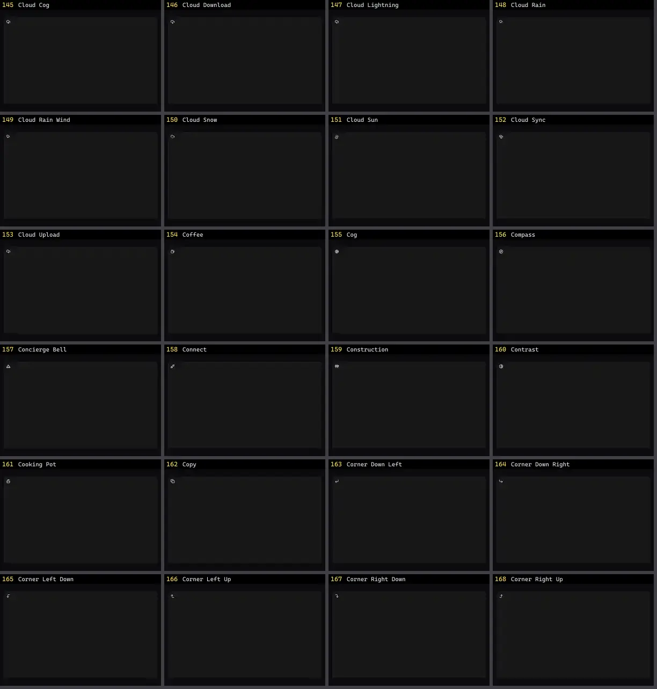

# Ícone — folha 7

| nº | nome | uid | tipo de aplicação |
|---|---|---|---|
| 145 | Cloud Cog | `lucideanimated:cloud-cog` | UI base |
| 146 | Cloud Download | `lucideanimated:cloud-download` | UI base |
| 147 | Cloud Lightning | `lucideanimated:cloud-lightning` | UI base |
| 148 | Cloud Rain | `lucideanimated:cloud-rain` | UI base |
| 149 | Cloud Rain Wind | `lucideanimated:cloud-rain-wind` | UI base |
| 150 | Cloud Snow | `lucideanimated:cloud-snow` | UI base |
| 151 | Cloud Sun | `lucideanimated:cloud-sun` | UI base |
| 152 | Cloud Sync | `lucideanimated:cloud-sync` | UI base |
| 153 | Cloud Upload | `lucideanimated:cloud-upload` | UI base |
| 154 | Coffee | `lucideanimated:coffee` | UI base |
| 155 | Cog | `lucideanimated:cog` | UI base |
| 156 | Compass | `lucideanimated:compass` | UI base |
| 157 | Concierge Bell | `lucideanimated:concierge-bell` | UI base |
| 158 | Connect | `lucideanimated:connect` | UI base |
| 159 | Construction | `lucideanimated:construction` | UI base |
| 160 | Contrast | `lucideanimated:contrast` | UI base |
| 161 | Cooking Pot | `lucideanimated:cooking-pot` | UI base |
| 162 | Copy | `lucideanimated:copy` | UI base |
| 163 | Corner Down Left | `lucideanimated:corner-down-left` | UI base |
| 164 | Corner Down Right | `lucideanimated:corner-down-right` | UI base |
| 165 | Corner Left Down | `lucideanimated:corner-left-down` | UI base |
| 166 | Corner Left Up | `lucideanimated:corner-left-up` | UI base |
| 167 | Corner Right Down | `lucideanimated:corner-right-down` | UI base |
| 168 | Corner Right Up | `lucideanimated:corner-right-up` | UI base |
