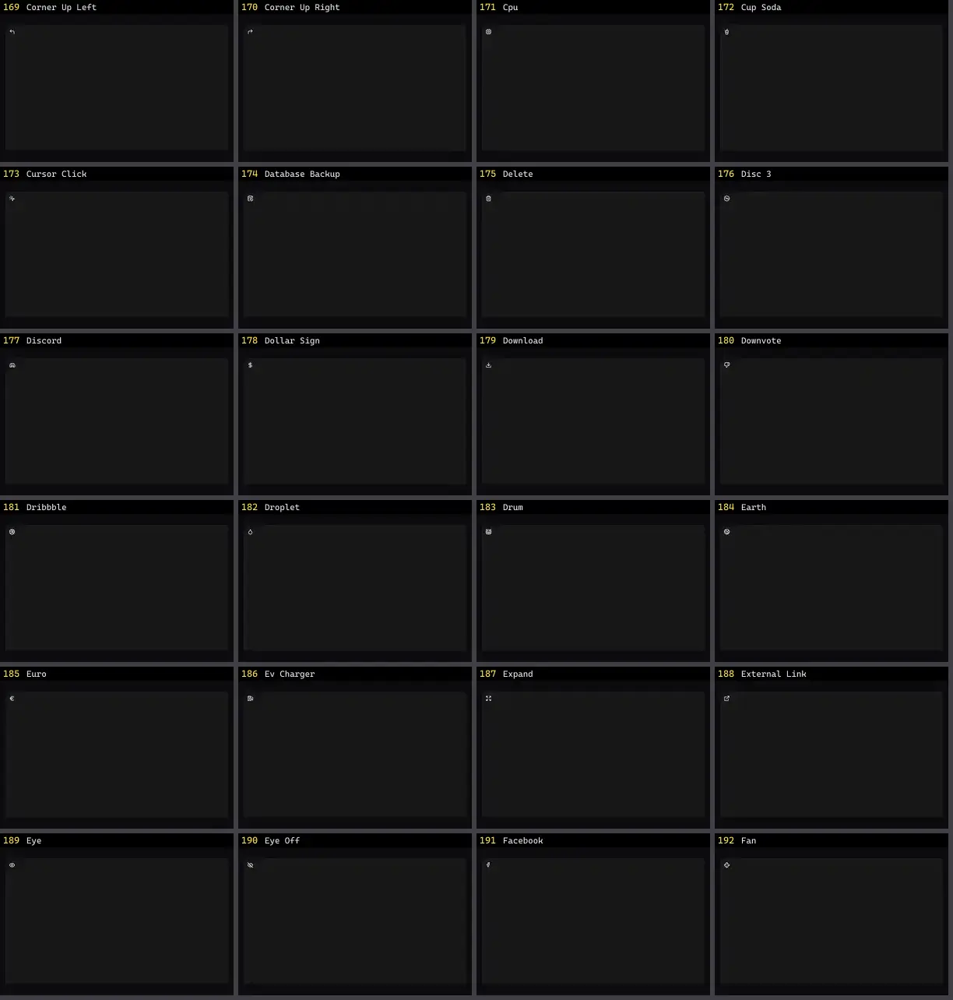

# Ícone — folha 8

| nº | nome | uid | tipo de aplicação |
|---|---|---|---|
| 169 | Corner Up Left | `lucideanimated:corner-up-left` | UI base |
| 170 | Corner Up Right | `lucideanimated:corner-up-right` | UI base |
| 171 | Cpu | `lucideanimated:cpu` | UI base |
| 172 | Cup Soda | `lucideanimated:cup-soda` | UI base |
| 173 | Cursor Click | `lucideanimated:cursor-click` | UI base |
| 174 | Database Backup | `lucideanimated:database-backup` | UI base |
| 175 | Delete | `lucideanimated:delete` | UI base |
| 176 | Disc 3 | `lucideanimated:disc-3` | UI base |
| 177 | Discord | `lucideanimated:discord` | UI base |
| 178 | Dollar Sign | `lucideanimated:dollar-sign` | UI base |
| 179 | Download | `lucideanimated:download` | UI base |
| 180 | Downvote | `lucideanimated:downvote` | UI base |
| 181 | Dribbble | `lucideanimated:dribbble` | UI base |
| 182 | Droplet | `lucideanimated:droplet` | UI base |
| 183 | Drum | `lucideanimated:drum` | UI base |
| 184 | Earth | `lucideanimated:earth` | UI base |
| 185 | Euro | `lucideanimated:euro` | UI base |
| 186 | Ev Charger | `lucideanimated:ev-charger` | UI base |
| 187 | Expand | `lucideanimated:expand` | UI base |
| 188 | External Link | `lucideanimated:external-link` | UI base |
| 189 | Eye | `lucideanimated:eye` | UI base |
| 190 | Eye Off | `lucideanimated:eye-off` | UI base |
| 191 | Facebook | `lucideanimated:facebook` | UI base |
| 192 | Fan | `lucideanimated:fan` | UI base |
