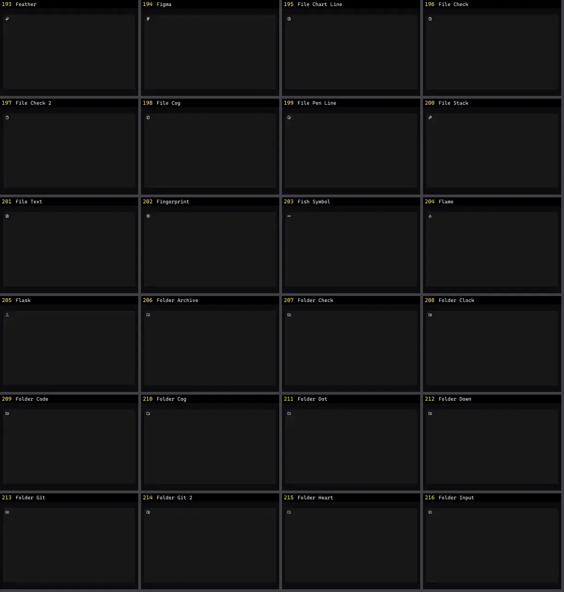

# Ícone — folha 9

| nº | nome | uid | tipo de aplicação |
|---|---|---|---|
| 193 | Feather | `lucideanimated:feather` | UI base |
| 194 | Figma | `lucideanimated:figma` | UI base |
| 195 | File Chart Line | `lucideanimated:file-chart-line` | UI base |
| 196 | File Check | `lucideanimated:file-check` | UI base |
| 197 | File Check 2 | `lucideanimated:file-check-2` | UI base |
| 198 | File Cog | `lucideanimated:file-cog` | UI base |
| 199 | File Pen Line | `lucideanimated:file-pen-line` | UI base |
| 200 | File Stack | `lucideanimated:file-stack` | UI base |
| 201 | File Text | `lucideanimated:file-text` | UI base |
| 202 | Fingerprint | `lucideanimated:fingerprint` | UI base |
| 203 | Fish Symbol | `lucideanimated:fish-symbol` | UI base |
| 204 | Flame | `lucideanimated:flame` | UI base |
| 205 | Flask | `lucideanimated:flask` | UI base |
| 206 | Folder Archive | `lucideanimated:folder-archive` | UI base |
| 207 | Folder Check | `lucideanimated:folder-check` | UI base |
| 208 | Folder Clock | `lucideanimated:folder-clock` | UI base |
| 209 | Folder Code | `lucideanimated:folder-code` | UI base |
| 210 | Folder Cog | `lucideanimated:folder-cog` | UI base |
| 211 | Folder Dot | `lucideanimated:folder-dot` | UI base |
| 212 | Folder Down | `lucideanimated:folder-down` | UI base |
| 213 | Folder Git | `lucideanimated:folder-git` | UI base |
| 214 | Folder Git 2 | `lucideanimated:folder-git-2` | UI base |
| 215 | Folder Heart | `lucideanimated:folder-heart` | UI base |
| 216 | Folder Input | `lucideanimated:folder-input` | UI base |
