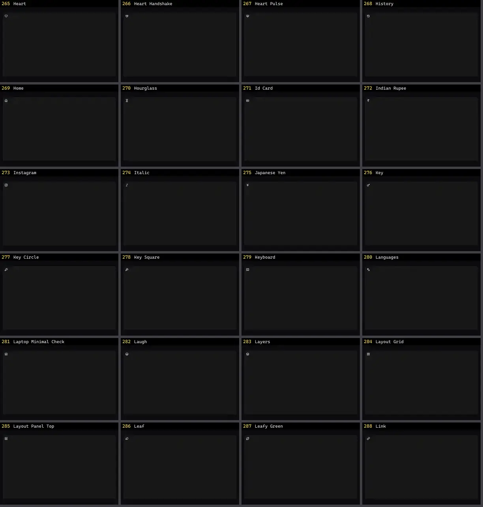

# Ícone — folha 12

| nº | nome | uid | tipo de aplicação |
|---|---|---|---|
| 265 | Heart | `lucideanimated:heart` | UI base |
| 266 | Heart Handshake | `lucideanimated:heart-handshake` | UI base |
| 267 | Heart Pulse | `lucideanimated:heart-pulse` | UI base |
| 268 | History | `lucideanimated:history` | UI base |
| 269 | Home | `lucideanimated:home` | UI base |
| 270 | Hourglass | `lucideanimated:hourglass` | UI base |
| 271 | Id Card | `lucideanimated:id-card` | UI base |
| 272 | Indian Rupee | `lucideanimated:indian-rupee` | UI base |
| 273 | Instagram | `lucideanimated:instagram` | UI base |
| 274 | Italic | `lucideanimated:italic` | UI base |
| 275 | Japanese Yen | `lucideanimated:japanese-yen` | UI base |
| 276 | Key | `lucideanimated:key` | UI base |
| 277 | Key Circle | `lucideanimated:key-circle` | UI base |
| 278 | Key Square | `lucideanimated:key-square` | UI base |
| 279 | Keyboard | `lucideanimated:keyboard` | UI base |
| 280 | Languages | `lucideanimated:languages` | UI base |
| 281 | Laptop Minimal Check | `lucideanimated:laptop-minimal-check` | UI base |
| 282 | Laugh | `lucideanimated:laugh` | UI base |
| 283 | Layers | `lucideanimated:layers` | UI base |
| 284 | Layout Grid | `lucideanimated:layout-grid` | UI base |
| 285 | Layout Panel Top | `lucideanimated:layout-panel-top` | UI base |
| 286 | Leaf | `lucideanimated:leaf` | UI base |
| 287 | Leafy Green | `lucideanimated:leafy-green` | UI base |
| 288 | Link | `lucideanimated:link` | UI base |
