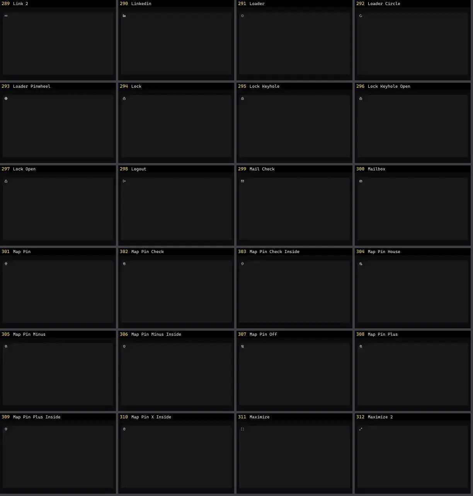

# Ícone — folha 13

| nº | nome | uid | tipo de aplicação |
|---|---|---|---|
| 289 | Link 2 | `lucideanimated:link-2` | UI base |
| 290 | Linkedin | `lucideanimated:linkedin` | UI base |
| 291 | Loader | `lucideanimated:loader` | UI base |
| 292 | Loader Circle | `lucideanimated:loader-circle` | UI base |
| 293 | Loader Pinwheel | `lucideanimated:loader-pinwheel` | UI base |
| 294 | Lock | `lucideanimated:lock` | UI base |
| 295 | Lock Keyhole | `lucideanimated:lock-keyhole` | UI base |
| 296 | Lock Keyhole Open | `lucideanimated:lock-keyhole-open` | UI base |
| 297 | Lock Open | `lucideanimated:lock-open` | UI base |
| 298 | Logout | `lucideanimated:logout` | UI base |
| 299 | Mail Check | `lucideanimated:mail-check` | UI base |
| 300 | Mailbox | `lucideanimated:mailbox` | UI base |
| 301 | Map Pin | `lucideanimated:map-pin` | UI base |
| 302 | Map Pin Check | `lucideanimated:map-pin-check` | UI base |
| 303 | Map Pin Check Inside | `lucideanimated:map-pin-check-inside` | UI base |
| 304 | Map Pin House | `lucideanimated:map-pin-house` | UI base |
| 305 | Map Pin Minus | `lucideanimated:map-pin-minus` | UI base |
| 306 | Map Pin Minus Inside | `lucideanimated:map-pin-minus-inside` | UI base |
| 307 | Map Pin Off | `lucideanimated:map-pin-off` | UI base |
| 308 | Map Pin Plus | `lucideanimated:map-pin-plus` | UI base |
| 309 | Map Pin Plus Inside | `lucideanimated:map-pin-plus-inside` | UI base |
| 310 | Map Pin X Inside | `lucideanimated:map-pin-x-inside` | UI base |
| 311 | Maximize | `lucideanimated:maximize` | UI base |
| 312 | Maximize 2 | `lucideanimated:maximize-2` | UI base |
