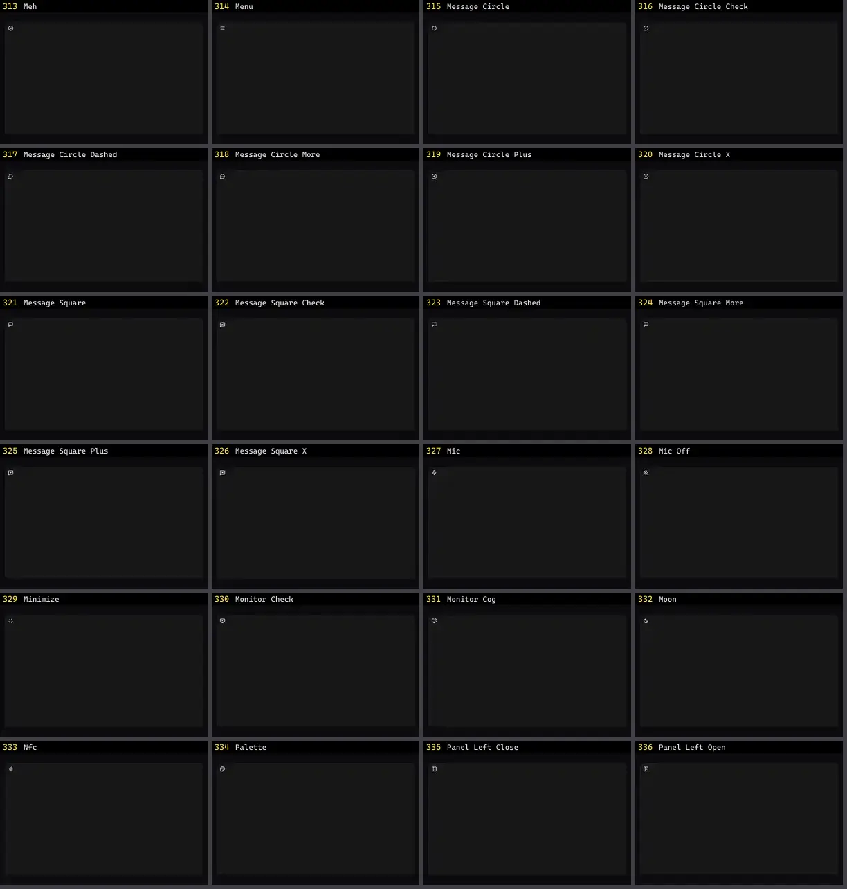

# Ícone — folha 14

| nº | nome | uid | tipo de aplicação |
|---|---|---|---|
| 313 | Meh | `lucideanimated:meh` | UI base |
| 314 | Menu | `lucideanimated:menu` | UI base |
| 315 | Message Circle | `lucideanimated:message-circle` | UI base |
| 316 | Message Circle Check | `lucideanimated:message-circle-check` | UI base |
| 317 | Message Circle Dashed | `lucideanimated:message-circle-dashed` | UI base |
| 318 | Message Circle More | `lucideanimated:message-circle-more` | UI base |
| 319 | Message Circle Plus | `lucideanimated:message-circle-plus` | UI base |
| 320 | Message Circle X | `lucideanimated:message-circle-x` | UI base |
| 321 | Message Square | `lucideanimated:message-square` | UI base |
| 322 | Message Square Check | `lucideanimated:message-square-check` | UI base |
| 323 | Message Square Dashed | `lucideanimated:message-square-dashed` | UI base |
| 324 | Message Square More | `lucideanimated:message-square-more` | UI base |
| 325 | Message Square Plus | `lucideanimated:message-square-plus` | UI base |
| 326 | Message Square X | `lucideanimated:message-square-x` | UI base |
| 327 | Mic | `lucideanimated:mic` | UI base |
| 328 | Mic Off | `lucideanimated:mic-off` | UI base |
| 329 | Minimize | `lucideanimated:minimize` | UI base |
| 330 | Monitor Check | `lucideanimated:monitor-check` | UI base |
| 331 | Monitor Cog | `lucideanimated:monitor-cog` | UI base |
| 332 | Moon | `lucideanimated:moon` | UI base |
| 333 | Nfc | `lucideanimated:nfc` | UI base |
| 334 | Palette | `lucideanimated:palette` | UI base |
| 335 | Panel Left Close | `lucideanimated:panel-left-close` | UI base |
| 336 | Panel Left Open | `lucideanimated:panel-left-open` | UI base |
