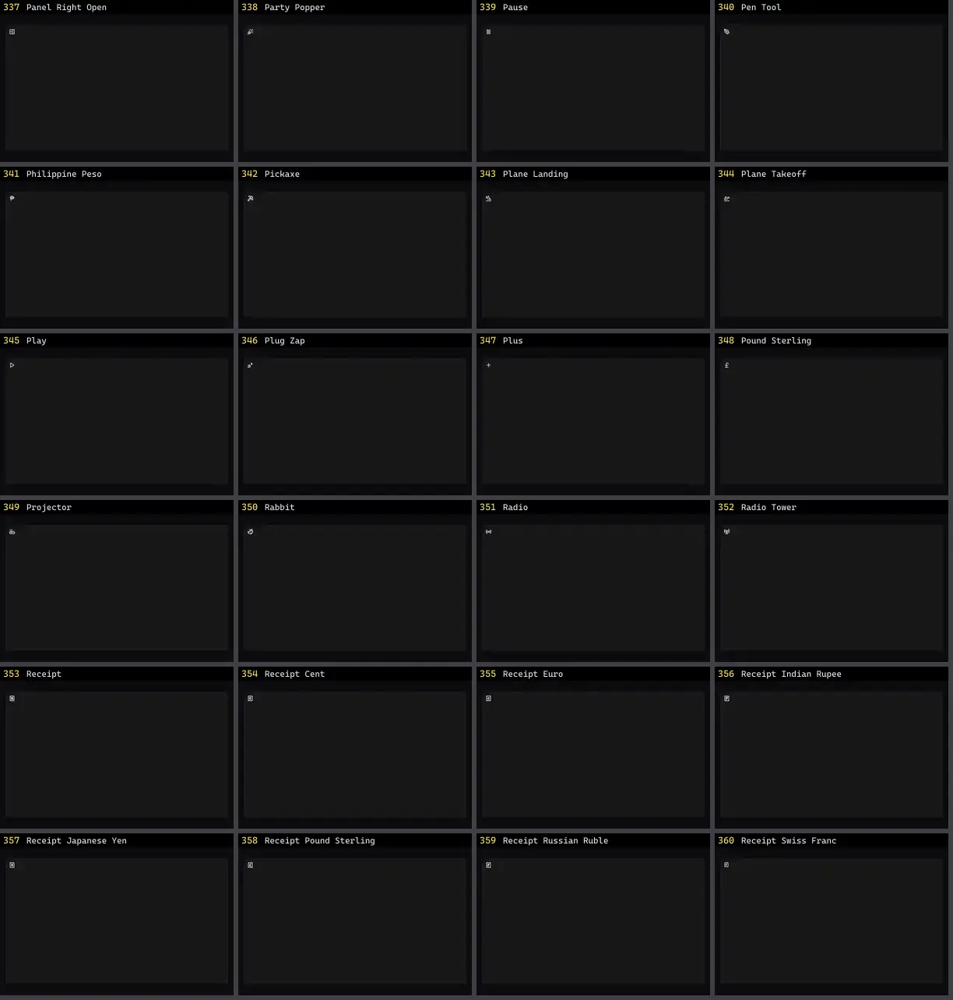

# Ícone — folha 15

| nº | nome | uid | tipo de aplicação |
|---|---|---|---|
| 337 | Panel Right Open | `lucideanimated:panel-right-open` | UI base |
| 338 | Party Popper | `lucideanimated:party-popper` | UI base |
| 339 | Pause | `lucideanimated:pause` | UI base |
| 340 | Pen Tool | `lucideanimated:pen-tool` | UI base |
| 341 | Philippine Peso | `lucideanimated:philippine-peso` | UI base |
| 342 | Pickaxe | `lucideanimated:pickaxe` | UI base |
| 343 | Plane Landing | `lucideanimated:plane-landing` | UI base |
| 344 | Plane Takeoff | `lucideanimated:plane-takeoff` | UI base |
| 345 | Play | `lucideanimated:play` | UI base |
| 346 | Plug Zap | `lucideanimated:plug-zap` | UI base |
| 347 | Plus | `lucideanimated:plus` | UI base |
| 348 | Pound Sterling | `lucideanimated:pound-sterling` | UI base |
| 349 | Projector | `lucideanimated:projector` | UI base |
| 350 | Rabbit | `lucideanimated:rabbit` | UI base |
| 351 | Radio | `lucideanimated:radio` | UI base |
| 352 | Radio Tower | `lucideanimated:radio-tower` | UI base |
| 353 | Receipt | `lucideanimated:receipt` | UI base |
| 354 | Receipt Cent | `lucideanimated:receipt-cent` | UI base |
| 355 | Receipt Euro | `lucideanimated:receipt-euro` | UI base |
| 356 | Receipt Indian Rupee | `lucideanimated:receipt-indian-rupee` | UI base |
| 357 | Receipt Japanese Yen | `lucideanimated:receipt-japanese-yen` | UI base |
| 358 | Receipt Pound Sterling | `lucideanimated:receipt-pound-sterling` | UI base |
| 359 | Receipt Russian Ruble | `lucideanimated:receipt-russian-ruble` | UI base |
| 360 | Receipt Swiss Franc | `lucideanimated:receipt-swiss-franc` | UI base |
