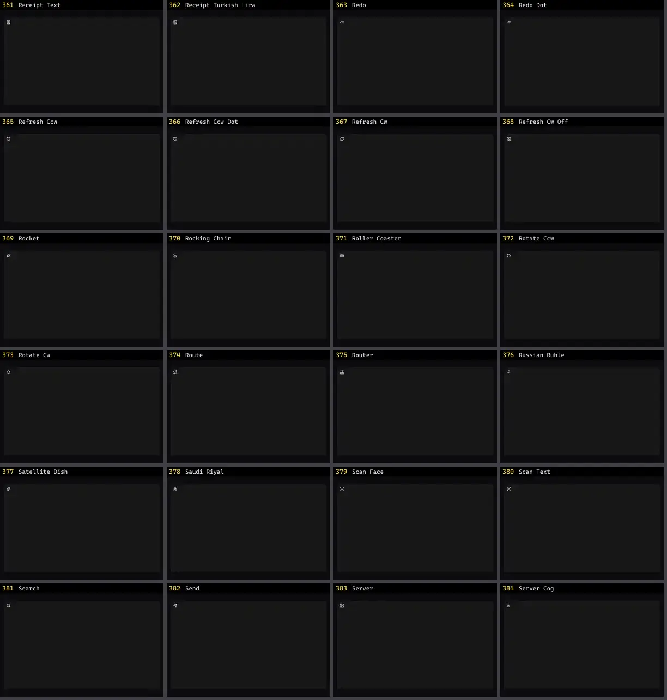

# Ícone — folha 16

| nº | nome | uid | tipo de aplicação |
|---|---|---|---|
| 361 | Receipt Text | `lucideanimated:receipt-text` | UI base |
| 362 | Receipt Turkish Lira | `lucideanimated:receipt-turkish-lira` | UI base |
| 363 | Redo | `lucideanimated:redo` | UI base |
| 364 | Redo Dot | `lucideanimated:redo-dot` | UI base |
| 365 | Refresh Ccw | `lucideanimated:refresh-ccw` | UI base |
| 366 | Refresh Ccw Dot | `lucideanimated:refresh-ccw-dot` | UI base |
| 367 | Refresh Cw | `lucideanimated:refresh-cw` | UI base |
| 368 | Refresh Cw Off | `lucideanimated:refresh-cw-off` | UI base |
| 369 | Rocket | `lucideanimated:rocket` | UI base |
| 370 | Rocking Chair | `lucideanimated:rocking-chair` | UI base |
| 371 | Roller Coaster | `lucideanimated:roller-coaster` | UI base |
| 372 | Rotate Ccw | `lucideanimated:rotate-ccw` | UI base |
| 373 | Rotate Cw | `lucideanimated:rotate-cw` | UI base |
| 374 | Route | `lucideanimated:route` | UI base |
| 375 | Router | `lucideanimated:router` | UI base |
| 376 | Russian Ruble | `lucideanimated:russian-ruble` | UI base |
| 377 | Satellite Dish | `lucideanimated:satellite-dish` | UI base |
| 378 | Saudi Riyal | `lucideanimated:saudi-riyal` | UI base |
| 379 | Scan Face | `lucideanimated:scan-face` | UI base |
| 380 | Scan Text | `lucideanimated:scan-text` | UI base |
| 381 | Search | `lucideanimated:search` | UI base |
| 382 | Send | `lucideanimated:send` | UI base |
| 383 | Server | `lucideanimated:server` | UI base |
| 384 | Server Cog | `lucideanimated:server-cog` | UI base |
