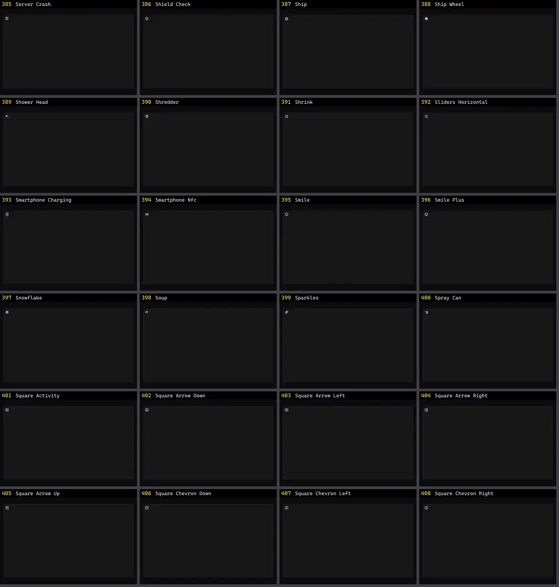

# Ícone — folha 17

| nº | nome | uid | tipo de aplicação |
|---|---|---|---|
| 385 | Server Crash | `lucideanimated:server-crash` | UI base |
| 386 | Shield Check | `lucideanimated:shield-check` | UI base |
| 387 | Ship | `lucideanimated:ship` | UI base |
| 388 | Ship Wheel | `lucideanimated:ship-wheel` | UI base |
| 389 | Shower Head | `lucideanimated:shower-head` | UI base |
| 390 | Shredder | `lucideanimated:shredder` | UI base |
| 391 | Shrink | `lucideanimated:shrink` | UI base |
| 392 | Sliders Horizontal | `lucideanimated:sliders-horizontal` | UI base |
| 393 | Smartphone Charging | `lucideanimated:smartphone-charging` | UI base |
| 394 | Smartphone Nfc | `lucideanimated:smartphone-nfc` | UI base |
| 395 | Smile | `lucideanimated:smile` | UI base |
| 396 | Smile Plus | `lucideanimated:smile-plus` | UI base |
| 397 | Snowflake | `lucideanimated:snowflake` | UI base |
| 398 | Soup | `lucideanimated:soup` | UI base |
| 399 | Sparkles | `lucideanimated:sparkles` | UI base |
| 400 | Spray Can | `lucideanimated:spray-can` | UI base |
| 401 | Square Activity | `lucideanimated:square-activity` | UI base |
| 402 | Square Arrow Down | `lucideanimated:square-arrow-down` | UI base |
| 403 | Square Arrow Left | `lucideanimated:square-arrow-left` | UI base |
| 404 | Square Arrow Right | `lucideanimated:square-arrow-right` | UI base |
| 405 | Square Arrow Up | `lucideanimated:square-arrow-up` | UI base |
| 406 | Square Chevron Down | `lucideanimated:square-chevron-down` | UI base |
| 407 | Square Chevron Left | `lucideanimated:square-chevron-left` | UI base |
| 408 | Square Chevron Right | `lucideanimated:square-chevron-right` | UI base |
