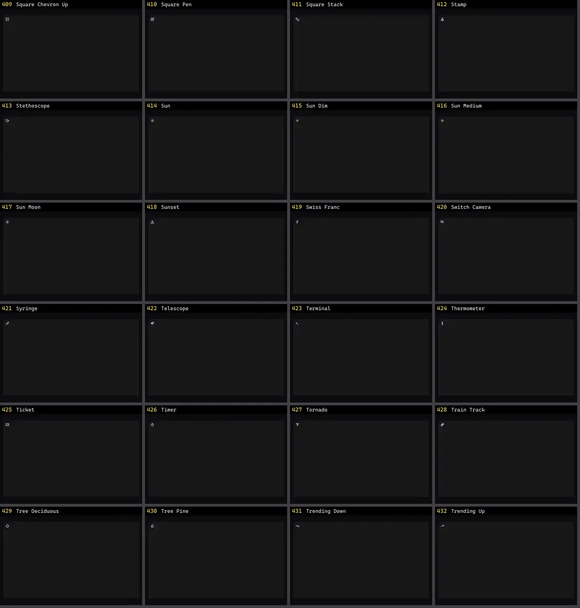

# Ícone — folha 18

| nº | nome | uid | tipo de aplicação |
|---|---|---|---|
| 409 | Square Chevron Up | `lucideanimated:square-chevron-up` | UI base |
| 410 | Square Pen | `lucideanimated:square-pen` | UI base |
| 411 | Square Stack | `lucideanimated:square-stack` | UI base |
| 412 | Stamp | `lucideanimated:stamp` | UI base |
| 413 | Stethoscope | `lucideanimated:stethoscope` | UI base |
| 414 | Sun | `lucideanimated:sun` | UI base |
| 415 | Sun Dim | `lucideanimated:sun-dim` | UI base |
| 416 | Sun Medium | `lucideanimated:sun-medium` | UI base |
| 417 | Sun Moon | `lucideanimated:sun-moon` | UI base |
| 418 | Sunset | `lucideanimated:sunset` | UI base |
| 419 | Swiss Franc | `lucideanimated:swiss-franc` | UI base |
| 420 | Switch Camera | `lucideanimated:switch-camera` | UI base |
| 421 | Syringe | `lucideanimated:syringe` | UI base |
| 422 | Telescope | `lucideanimated:telescope` | UI base |
| 423 | Terminal | `lucideanimated:terminal` | UI base |
| 424 | Thermometer | `lucideanimated:thermometer` | UI base |
| 425 | Ticket | `lucideanimated:ticket` | UI base |
| 426 | Timer | `lucideanimated:timer` | UI base |
| 427 | Tornado | `lucideanimated:tornado` | UI base |
| 428 | Train Track | `lucideanimated:train-track` | UI base |
| 429 | Tree Deciduous | `lucideanimated:tree-deciduous` | UI base |
| 430 | Tree Pine | `lucideanimated:tree-pine` | UI base |
| 431 | Trending Down | `lucideanimated:trending-down` | UI base |
| 432 | Trending Up | `lucideanimated:trending-up` | UI base |
