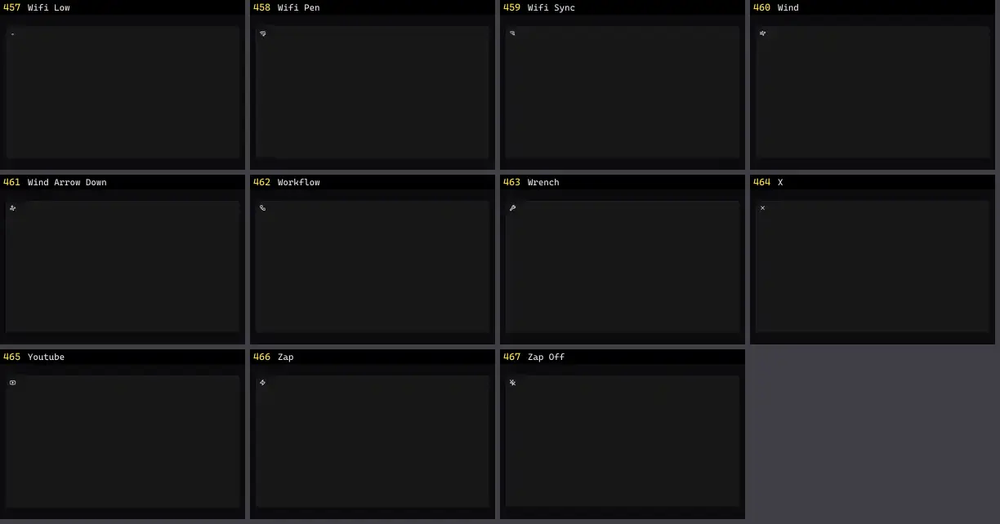

# Ícone — folha 20

| nº | nome | uid | tipo de aplicação |
|---|---|---|---|
| 457 | Wifi Low | `lucideanimated:wifi-low` | UI base |
| 458 | Wifi Pen | `lucideanimated:wifi-pen` | UI base |
| 459 | Wifi Sync | `lucideanimated:wifi-sync` | UI base |
| 460 | Wind | `lucideanimated:wind` | UI base |
| 461 | Wind Arrow Down | `lucideanimated:wind-arrow-down` | UI base |
| 462 | Workflow | `lucideanimated:workflow` | UI base |
| 463 | Wrench | `lucideanimated:wrench` | UI base |
| 464 | X | `lucideanimated:x` | UI base |
| 465 | Youtube | `lucideanimated:youtube` | UI base |
| 466 | Zap | `lucideanimated:zap` | UI base |
| 467 | Zap Off | `lucideanimated:zap-off` | UI base |
