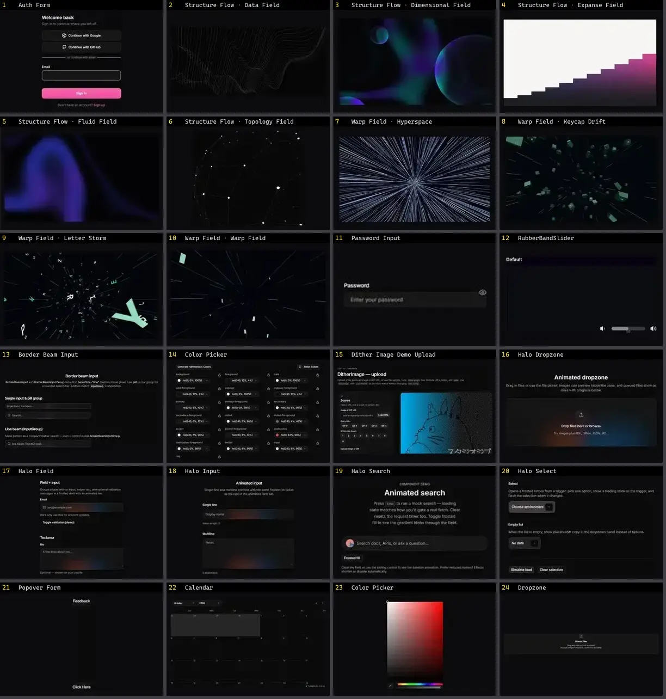

# Input — folha 1

| nº | nome | uid | tipo de aplicação |
|---|---|---|---|
| 1 | Auth Form | `smoothui:auth-form` | Login & Conta |
| 2 | Structure Flow · Data Field | `threeui:structure-flow/data-field` | Login & Conta |
| 3 | Structure Flow · Dimensional Field | `threeui:structure-flow/dimensional-field` | Login & Conta |
| 4 | Structure Flow · Expanse Field | `threeui:structure-flow/expanse-field` | Login & Conta |
| 5 | Structure Flow · Fluid Field | `threeui:structure-flow/fluid-field` | Login & Conta |
| 6 | Structure Flow · Topology Field | `threeui:structure-flow/topology-field` | Login & Conta |
| 7 | Warp Field · Hyperspace | `threeui:warp-field/hyperspace` | Login & Conta |
| 8 | Warp Field · Keycap Drift | `threeui:warp-field/keycaps` | Login & Conta |
| 9 | Warp Field · Letter Storm | `threeui:warp-field/letters` | Login & Conta |
| 10 | Warp Field · Warp Field | `threeui:warp-field/streaks` | Login & Conta |
| 11 | Password Input | `uitripled:inputs/password-input` | Login & Conta |
| 12 | RubberBandSlider | `atlas:Inputs/RubberBandSlider` | UI base |
| 13 | Border Beam Input | `cultui:border-beam-input-demo` | UI base |
| 14 | Color Picker | `cultui:color-picker-demo` | UI base |
| 15 | Dither Image Demo Upload | `cultui:dither-image-demo-upload` | UI base |
| 16 | Halo Dropzone | `cultui:halo-dropzone-demo` | UI base |
| 17 | Halo Field | `cultui:halo-field-demo` | UI base |
| 18 | Halo Input | `cultui:halo-input-demo` | UI base |
| 19 | Halo Search | `cultui:halo-search-demo` | UI base |
| 20 | Halo Select | `cultui:halo-select-demo` | UI base |
| 21 | Popover Form | `cultui:popover-form-demo` | UI base |
| 22 | Calendar | `kibo:calendar` | UI base |
| 23 | Color Picker | `kibo:color-picker` | UI base |
| 24 | Dropzone | `kibo:dropzone` | UI base |
