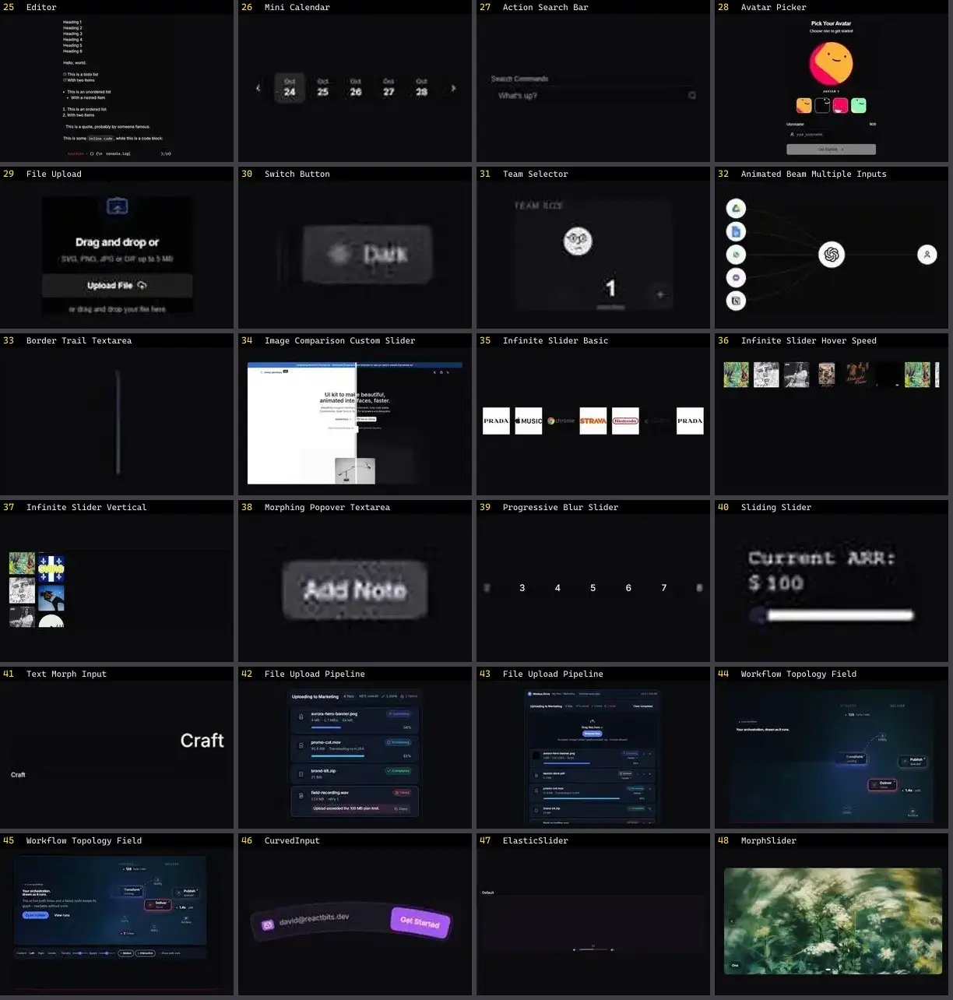

# Input — folha 2

| nº | nome | uid | tipo de aplicação |
|---|---|---|---|
| 25 | Editor | `kibo:editor` | UI base |
| 26 | Mini Calendar | `kibo:mini-calendar` | UI base |
| 27 | Action Search Bar | `kokonutui:action-search-bar` | UI base |
| 28 | Avatar Picker | `kokonutui:avatar-picker` | UI base |
| 29 | File Upload | `kokonutui:file-upload` | UI base |
| 30 | Switch Button | `kokonutui:switch-button` | UI base |
| 31 | Team Selector | `kokonutui:team-selector` | UI base |
| 32 | Animated Beam Multiple Inputs | `magicui:animated-beam-multiple-inputs` | UI base |
| 33 | Border Trail Textarea | `motionprimitives:border-trail/border-trail-textarea` | UI base |
| 34 | Image Comparison Custom Slider | `motionprimitives:image-comparison/image-comparison-custom-slider` | UI base |
| 35 | Infinite Slider Basic | `motionprimitives:infinite-slider/infinite-slider-basic` | UI base |
| 36 | Infinite Slider Hover Speed | `motionprimitives:infinite-slider/infinite-slider-hover-speed` | UI base |
| 37 | Infinite Slider Vertical | `motionprimitives:infinite-slider/infinite-slider-vertical` | UI base |
| 38 | Morphing Popover Textarea | `motionprimitives:morphing-popover/morphing-popover-textarea` | UI base |
| 39 | Progressive Blur Slider | `motionprimitives:progressive-blur/progressive-blur-slider` | UI base |
| 40 | Sliding Slider | `motionprimitives:sliding-number/sliding-slider` | UI base |
| 41 | Text Morph Input | `motionprimitives:text-morph/text-morph-input` | UI base |
| 42 | File Upload Pipeline | `motiq:catalog/file-upload-pipeline` | UI base |
| 43 | File Upload Pipeline | `motiq:file-upload-pipeline` | UI base |
| 44 | Workflow Topology Field | `motiq:catalog/workflow-topology-field` | UI base |
| 45 | Workflow Topology Field | `motiq:workflow-topology-field` | UI base |
| 46 | CurvedInput | `reactbits:Components/CurvedInputDemo` | UI base |
| 47 | ElasticSlider | `reactbits:Components/ElasticSliderDemo` | UI base |
| 48 | MorphSlider | `reactbits:Components/MorphSliderDemo` | UI base |
