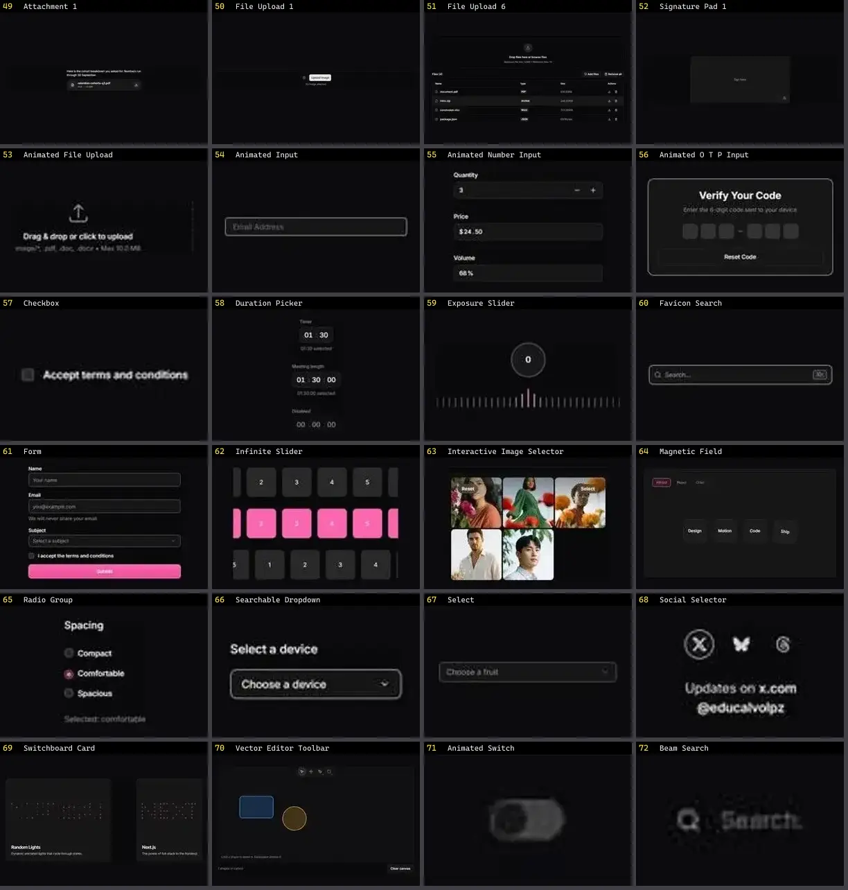

# Input — folha 3

| nº | nome | uid | tipo de aplicação |
|---|---|---|---|
| 49 | Signature Pad 1 | `reui:signature-pad/c-signature-pad-1` | UI base |
| 50 | Animated File Upload | `smoothui:animated-file-upload` | UI base |
| 51 | Animated Input | `smoothui:animated-input` | UI base |
| 52 | Animated Number Input | `smoothui:animated-number-input` | UI base |
| 53 | Animated O T P Input | `smoothui:animated-o-t-p-input` | UI base |
| 54 | Checkbox | `smoothui:checkbox` | UI base |
| 55 | Duration Picker | `smoothui:duration-picker` | UI base |
| 56 | Exposure Slider | `smoothui:exposure-slider` | UI base |
| 57 | Favicon Search | `smoothui:favicon-search` | UI base |
| 58 | Form | `smoothui:form` | UI base |
| 59 | Infinite Slider | `smoothui:infinite-slider` | UI base |
| 60 | Interactive Image Selector | `smoothui:interactive-image-selector` | UI base |
| 61 | Magnetic Field | `smoothui:magnetic-field` | UI base |
| 62 | Radio Group | `smoothui:radio-group` | UI base |
| 63 | Searchable Dropdown | `smoothui:searchable-dropdown` | UI base |
| 64 | Select | `smoothui:select` | UI base |
| 65 | Social Selector | `smoothui:social-selector` | UI base |
| 66 | Switchboard Card | `smoothui:switchboard-card` | UI base |
| 67 | Vector Editor Toolbar | `smoothui:vector-editor-toolbar` | UI base |
| 68 | Animated Switch | `spectrumui:animated-switch` | UI base |
| 69 | Beam Search | `spectrumui:beam-search` | UI base |
| 70 | Command Search | `spectrumui:command-search` | UI base |
| 71 | Form | `spectrumui:form` | UI base |
| 72 | Link Search Footer | `spectrumui:blocks/footers/link-search-footer` | UI base |
