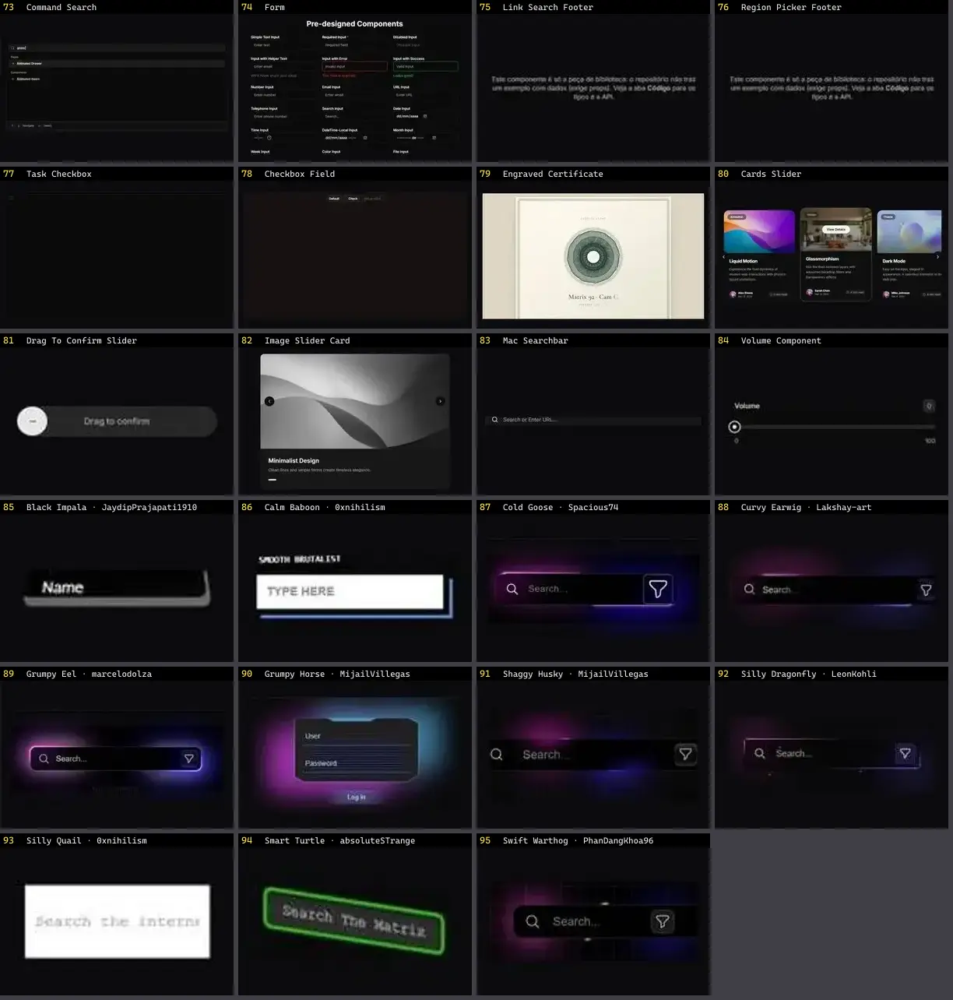

# Input — folha 4

| nº | nome | uid | tipo de aplicação |
|---|---|---|---|
| 73 | Command Search | `spectrumui:command-search` | UI base |
| 74 | Form | `spectrumui:form` | UI base |
| 75 | Link Search Footer | `spectrumui:blocks/footers/link-search-footer` | UI base |
| 76 | Region Picker Footer | `spectrumui:blocks/footers/region-picker-footer` | UI base |
| 77 | Task Checkbox | `spectrumui:task-checkbox` | UI base |
| 78 | Checkbox Field | `systaliko:components/checkbox-field` | UI base |
| 79 | Engraved Certificate | `threeui:engraved-certificate` | UI base |
| 80 | Cards Slider | `uitripled:components/sliders/cards-slider` | UI base |
| 81 | Drag To Confirm Slider | `uitripled:motion-core/drag-to-confirm-slider` | UI base |
| 82 | Image Slider Card | `uitripled:components/cards/image-slider-card` | UI base |
| 83 | Mac Searchbar | `uitripled:search/mac-searchbar` | UI base |
| 84 | Volume Component | `uitripled:components/sliders/volume-component` | UI base |
| 85 | Black Impala · JaydipPrajapati1910 | `uiverse:Inputs/JaydipPrajapati1910_black-impala-70` | UI base |
| 86 | Calm Baboon · 0xnihilism | `uiverse:Inputs/0xnihilism_calm-baboon-55` | UI base |
| 87 | Cold Goose · Spacious74 | `uiverse:Inputs/Spacious74_cold-goose-63` | UI base |
| 88 | Curvy Earwig · Lakshay-art | `uiverse:Inputs/Lakshay-art_curvy-earwig-22` | UI base |
| 89 | Grumpy Eel · marcelodolza | `uiverse:Inputs/marcelodolza_grumpy-eel-20` | UI base |
| 90 | Grumpy Horse · MijailVillegas | `uiverse:Inputs/MijailVillegas_grumpy-horse-85` | UI base |
| 91 | Shaggy Husky · MijailVillegas | `uiverse:Inputs/MijailVillegas_shaggy-husky-62` | UI base |
| 92 | Silly Dragonfly · LeonKohli | `uiverse:Inputs/LeonKohli_silly-dragonfly-82` | UI base |
| 93 | Silly Quail · 0xnihilism | `uiverse:Inputs/0xnihilism_silly-quail-9` | UI base |
| 94 | Smart Turtle · absoluteSTrange | `uiverse:Inputs/absoluteSTrange_smart-turtle-82` | UI base |
| 95 | Swift Warthog · PhanDangKhoa96 | `uiverse:Inputs/PhanDangKhoa96_swift-warthog-78` | UI base |
