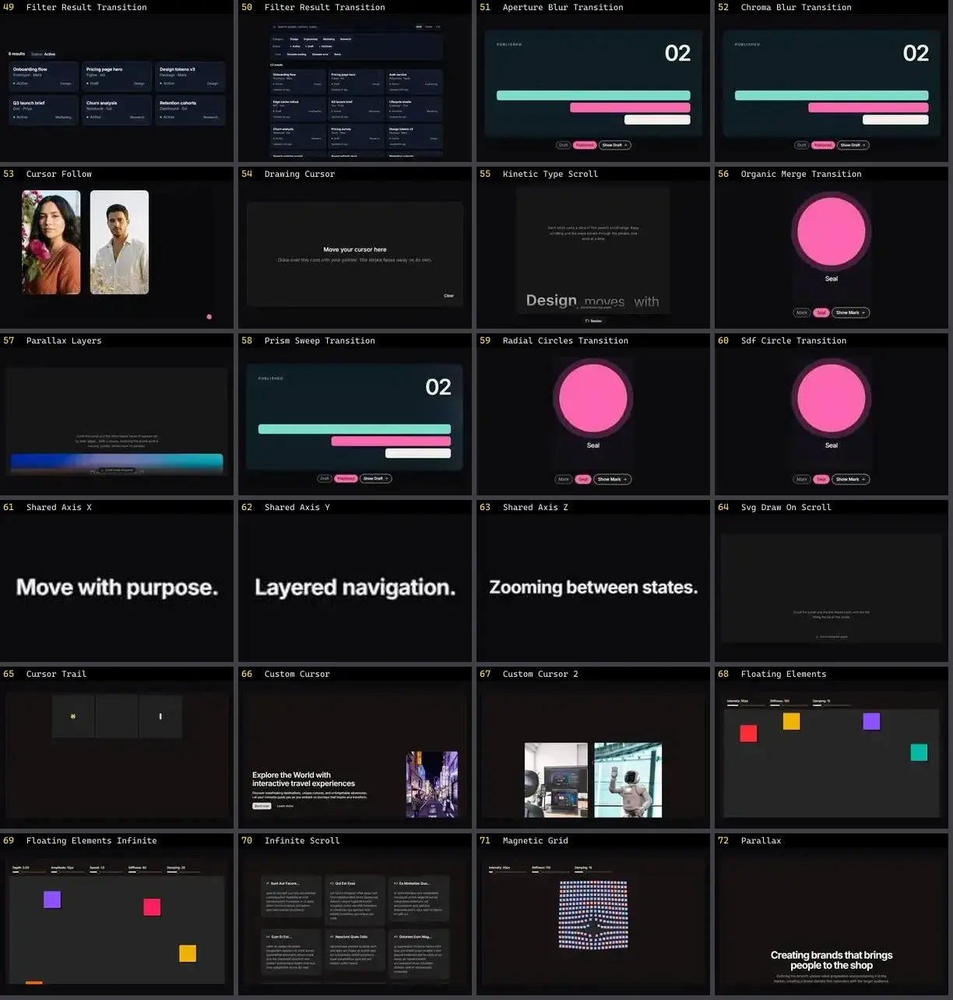

# Interação & Cursor — folha 3

| nº | nome | uid | tipo de aplicação |
|---|---|---|---|
| 49 | Magnetic Basic | `motionprimitives:magnetic/magnetic-basic` | Efeitos & Animação |
| 50 | Magnetic Nested | `motionprimitives:magnetic/magnetic-nested` | Efeitos & Animação |
| 51 | Cursor Comet | `motiq:cursor-comet` | Efeitos & Animação |
| 52 | Depth Parallax Scene | `motiq:depth-parallax-scene` | Efeitos & Animação |
| 53 | Filter Result Transition | `motiq:catalog/filter-result-transition` | Efeitos & Animação |
| 54 | Filter Result Transition | `motiq:filter-result-transition` | Efeitos & Animação |
| 55 | BellToggle | `reactbits:Micro/BellToggleDemo` | Efeitos & Animação |
| 56 | BranchedMenu | `reactbits:Micro/BranchedMenuDemo` | Efeitos & Animação |
| 57 | CallChip | `reactbits:Micro/CallChipDemo` | Efeitos & Animação |
| 58 | CodeSlots | `reactbits:Micro/CodeSlotsDemo` | Efeitos & Animação |
| 59 | CometDial | `reactbits:Micro/CometDialDemo` | Efeitos & Animação |
| 60 | DodgeField | `reactbits:Micro/DodgeFieldDemo` | Efeitos & Animação |
| 61 | FlipCard | `reactbits:Micro/FlipCardDemo` | Efeitos & Animação |
| 62 | FolderFloat | `reactbits:Micro/FolderFloatDemo` | Efeitos & Animação |
| 63 | FuseButton | `reactbits:Micro/FuseButtonDemo` | Efeitos & Animação |
| 64 | GlideSelect | `reactbits:Micro/GlideSelectDemo` | Efeitos & Animação |
| 65 | HoldButton | `reactbits:Micro/HoldButtonDemo` | Efeitos & Animação |
| 66 | JellyRadio | `reactbits:Micro/JellyRadioDemo` | Efeitos & Animação |
| 67 | LatticeLoader | `reactbits:Micro/LatticeLoaderDemo` | Efeitos & Animação |
| 68 | PaperCrumple | `reactbits:Micro/PaperCrumpleDemo` | Efeitos & Animação |
| 69 | PeekRating | `reactbits:Micro/PeekRatingDemo` | Efeitos & Animação |
| 70 | PromptBar | `reactbits:Micro/PromptBarDemo` | Efeitos & Animação |
| 71 | PulseHeart | `reactbits:Micro/PulseHeartDemo` | Efeitos & Animação |
| 72 | RefineFrame | `reactbits:Micro/RefineFrameDemo` | Efeitos & Animação |
