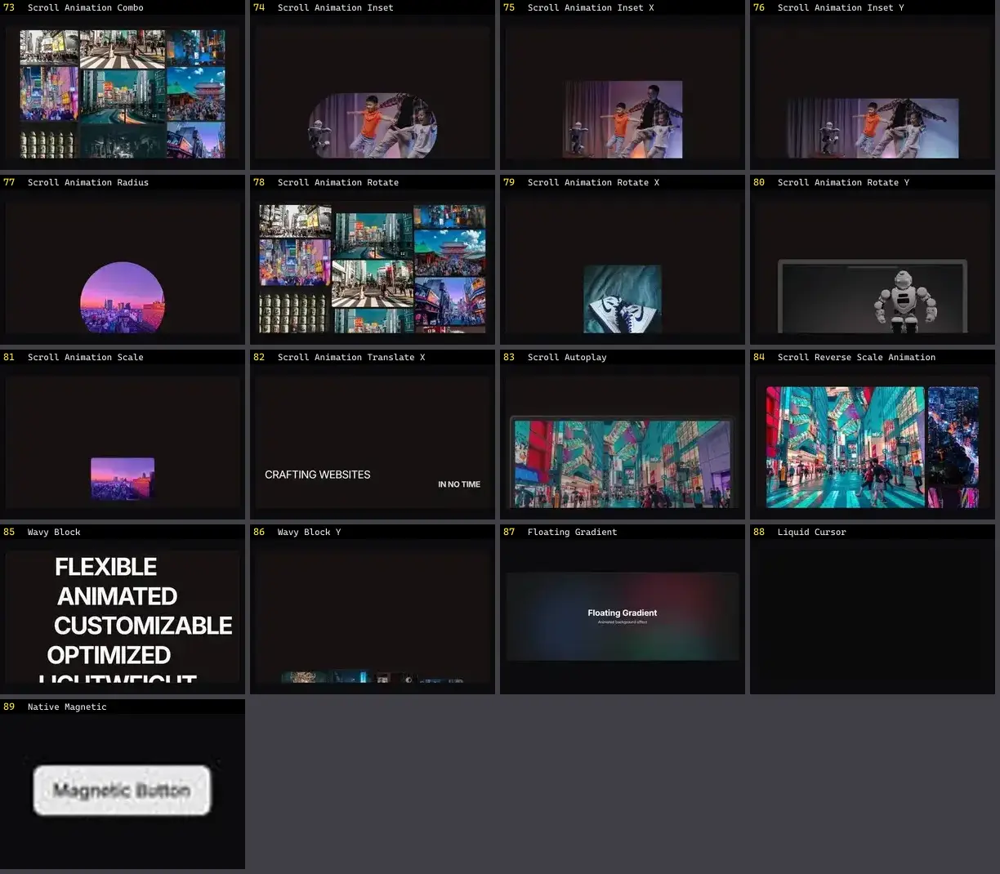

# Interação & Cursor — folha 4

| nº | nome | uid | tipo de aplicação |
|---|---|---|---|
| 73 | RubberSegment | `reactbits:Micro/RubberSegmentDemo` | Efeitos & Animação |
| 74 | ScrubField | `reactbits:Micro/ScrubFieldDemo` | Efeitos & Animação |
| 75 | Shredder | `reactbits:Micro/ShredderDemo` | Efeitos & Animação |
| 76 | SlideCommit | `reactbits:Micro/SlideCommitDemo` | Efeitos & Animação |
| 77 | SlingButton | `reactbits:Micro/SlingButtonDemo` | Efeitos & Animação |
| 78 | SloshGauge | `reactbits:Micro/SloshGaugeDemo` | Efeitos & Animação |
| 79 | SpringCheck | `reactbits:Micro/SpringCheckDemo` | Efeitos & Animação |
| 80 | SquishSwitch | `reactbits:Micro/SquishSwitchDemo` | Efeitos & Animação |
| 81 | StatusMark | `reactbits:Micro/StatusMarkDemo` | Efeitos & Animação |
| 82 | SwipeRow | `reactbits:Micro/SwipeRowDemo` | Efeitos & Animação |
| 83 | SwipeToast | `reactbits:Micro/SwipeToastDemo` | Efeitos & Animação |
| 84 | TearTicket | `reactbits:Micro/TearTicketDemo` | Efeitos & Animação |
| 85 | ThoughtLine | `reactbits:Micro/ThoughtLineDemo` | Efeitos & Animação |
| 86 | VoicePill | `reactbits:Micro/VoicePillDemo` | Efeitos & Animação |
| 87 | WakeSlider | `reactbits:Micro/WakeSliderDemo` | Efeitos & Animação |
| 88 | WarmTooltip | `reactbits:Micro/WarmTooltipDemo` | Efeitos & Animação |
| 89 | Aperture Blur Transition | `smoothui:aperture-blur-transition` | Efeitos & Animação |
| 90 | Chroma Blur Transition | `smoothui:chroma-blur-transition` | Efeitos & Animação |
| 91 | Cursor Follow | `smoothui:cursor-follow` | Efeitos & Animação |
| 92 | Drawing Cursor | `smoothui:drawing-cursor` | Efeitos & Animação |
| 93 | Kinetic Type Scroll | `smoothui:kinetic-type-scroll` | Efeitos & Animação |
| 94 | Organic Merge Transition | `smoothui:organic-merge-transition` | Efeitos & Animação |
| 95 | Parallax Layers | `smoothui:parallax-layers` | Efeitos & Animação |
| 96 | Prism Sweep Transition | `smoothui:prism-sweep-transition` | Efeitos & Animação |
