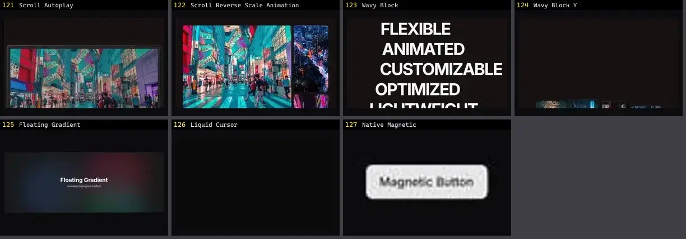

# Interação & Cursor — folha 6

| nº | nome | uid | tipo de aplicação |
|---|---|---|---|
| 121 | Scroll Autoplay | `systaliko:scroll-animations/scroll-autoplay` | Efeitos & Animação |
| 122 | Scroll Reverse Scale Animation | `systaliko:scroll-animations/scroll-reverse-scale-animation` | Efeitos & Animação |
| 123 | Wavy Block | `systaliko:scroll-animations/wavy-block` | Efeitos & Animação |
| 124 | Wavy Block Y | `systaliko:scroll-animations/wavy-block-y` | Efeitos & Animação |
| 125 | Floating Gradient | `uitripled:decorative/background/floating-gradient` | Efeitos & Animação |
| 126 | Liquid Cursor | `uitripled:liquid-cursor` | Efeitos & Animação |
| 127 | Native Magnetic | `uitripled:native/demo/native-magnetic-demo` | Efeitos & Animação |
