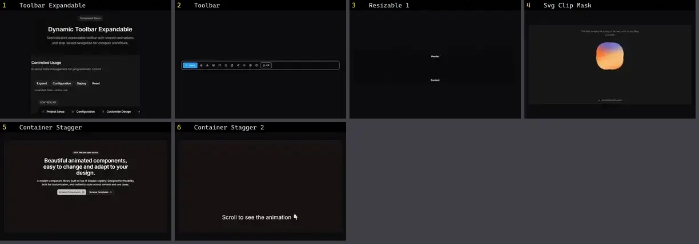

# Layout — folha 1

| nº | nome | uid | tipo de aplicação |
|---|---|---|---|
| 1 | Toolbar Expandable | `cultui:toolbar-expandable-demo` | UI base |
| 2 | Toolbar | `kokonutui:toolbar` | UI base |
| 3 | Resizable 1 | `reui:resizable/c-resizable-1` | UI base |
| 4 | Svg Clip Mask | `smoothui:svg-clip-mask` | UI base |
| 5 | Container Stagger | `systaliko:blocks/container-stagger` | UI base |
| 6 | Container Stagger 2 | `systaliko:blocks/container-stagger-2` | UI base |
