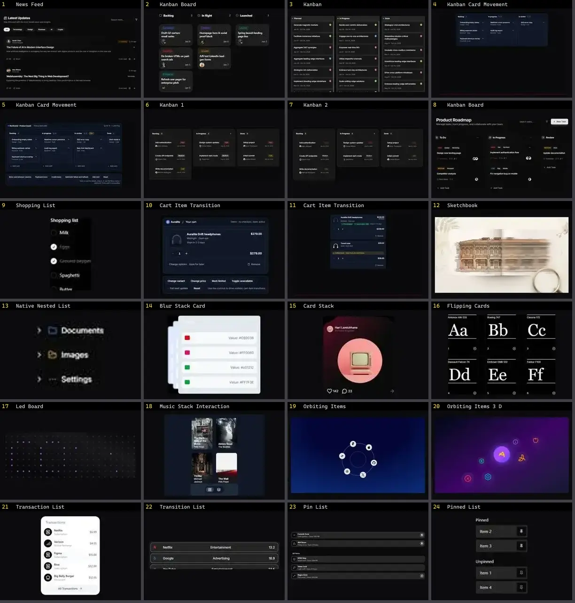

# Lista & Timeline — folha 1

| nº | nome | uid | tipo de aplicação |
|---|---|---|---|
| 1 | News Feed | `uitripled:components/news-feed/news-feed` | Blog & Conteúdo |
| 2 | Kanban Board | `cultui:kanban-board-demo` | Dashboard & Admin |
| 3 | Kanban | `kibo:kanban` | Dashboard & Admin |
| 4 | Kanban Card Movement | `motiq:catalog/kanban-card-movement` | Dashboard & Admin |
| 5 | Kanban Card Movement | `motiq:kanban-card-movement` | Dashboard & Admin |
| 6 | Kanban 1 | `reui:kanban/c-kanban-1` | Dashboard & Admin |
| 7 | Kanban 2 | `reui:kanban/c-kanban-2` | Dashboard & Admin |
| 8 | Kanban Board | `uitripled:components/kanban/kanban-board` | Dashboard & Admin |
| 9 | Shopping List | `animata:widget/shopping-list` | E-commerce |
| 10 | Cart Item Transition | `motiq:cart-item-transition` | E-commerce |
| 11 | Cart Item Transition | `motiq:catalog/cart-item-transition` | E-commerce |
| 12 | Sketchbook | `threeui:sketchbook` | Login & Conta |
| 13 | Native Nested List | `uitripled:native/demo/native-nested-list-demo` | Mobile & App |
| 14 | Blur Stack Card | `animata:card/blur-stack-card` | UI base |
| 15 | Card Stack | `animata:card/card-stack` | UI base |
| 16 | Flipping Cards | `animata:list/flipping-cards` | UI base |
| 17 | Led Board | `animata:card/led-board` | UI base |
| 18 | Music Stack Interaction | `animata:widget/music-stack-interaction` | UI base |
| 19 | Orbiting Items | `animata:list/orbiting-items` | UI base |
| 20 | Orbiting Items 3 D | `animata:list/orbiting-items-3-d` | UI base |
| 21 | Transaction List | `animata:list/transaction-list` | UI base |
| 22 | Transition List | `animata:list/transition-list` | UI base |
| 23 | Pin List | `animateui:components/community/pin-list` | UI base |
| 24 | Pinned List | `animateui:primitives/animate/pinned-list` | UI base |
