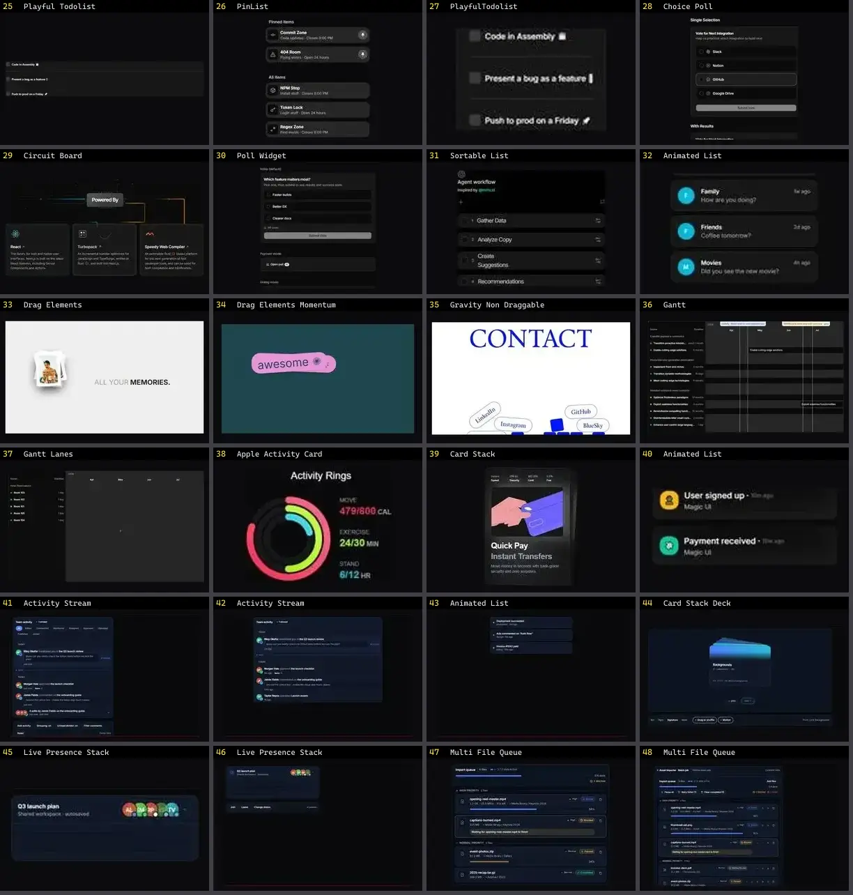

# Lista & Timeline — folha 2

| nº | nome | uid | tipo de aplicação |
|---|---|---|---|
| 25 | Playful Todolist | `animateui:components/community/playful-todolist` | UI base |
| 26 | PinList | `atlas:Lists/PinList` | UI base |
| 27 | PlayfulTodolist | `atlas:Lists/PlayfulTodolist` | UI base |
| 28 | Choice Poll | `cultui:choice-poll-demo` | UI base |
| 29 | Circuit Board | `cultui:circuit-board-demo` | UI base |
| 30 | Poll Widget | `cultui:poll-widget-demo` | UI base |
| 31 | Sortable List | `cultui:sortable-list-demo` | UI base |
| 32 | Animated List | `eldoraui:animated-list-demo` | UI base |
| 33 | Drag Elements | `fancy:blocks/drag-elements-demo` | UI base |
| 34 | Drag Elements Momentum | `fancy:blocks/drag-elements-momentum-demo` | UI base |
| 35 | Gravity Non Draggable | `fancy:physics/gravity-non-draggable-demo` | UI base |
| 36 | Gantt | `kibo:gantt` | UI base |
| 37 | Gantt Lanes | `kibo:gantt-lanes` | UI base |
| 38 | Apple Activity Card | `kokonutui:apple-activity-card` | UI base |
| 39 | Card Stack | `kokonutui:card-stack` | UI base |
| 40 | Animated List | `magicui:animated-list-demo` | UI base |
| 41 | Activity Stream | `motiq:activity-stream` | UI base |
| 42 | Activity Stream | `motiq:catalog/activity-stream` | UI base |
| 43 | Animated List | `motiq:catalog/animated-list` | UI base |
| 44 | Card Stack Deck | `motiq:card-stack-deck` | UI base |
| 45 | Live Presence Stack | `motiq:catalog/live-presence-stack` | UI base |
| 46 | Live Presence Stack | `motiq:live-presence-stack` | UI base |
| 47 | Multi File Queue | `motiq:catalog/multi-file-queue` | UI base |
| 48 | Multi File Queue | `motiq:multi-file-queue` | UI base |
